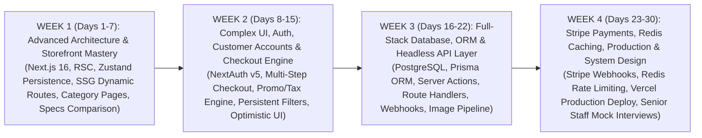

# 📌 30-Day Accelerated Full-Stack Engineering Mastery: Pinned Course Notes & Progress Tracker

> **Target Title:** Senior Frontend / Full-Stack Engineer | React | Next.js | TypeScript | E-Commerce | BigCommerce | Shopify  
> **Project Location:** `D:\NOVA Project\nova-ecommerce`  
> **PDF Study Guide Location:** `D:\NOVA Project\NOVA_Course_Day1_Day2_Notes.pdf`

---

## 🎯 30-Day Fast-Track Transformation Roadmap (1-Month Intensive)

---

## 🗺️ Codebase Architecture & System Dependency Diagram

```mermaid
flowchart TD
    subgraph Data & Contracts Layer
        Types["types/product.ts<br/>(Product, Category, CartItem, Review, AddressForm, Toast Interfaces)"]
        Data["data/products.ts<br/>(8 Flagship Products, Technical Specs, Verified Reviews & Lookup Utilities)"]
    end

    subgraph Global State Layer
        CartStore["store/useCartStore.ts<br/>(Zustand + Persist: Cart Items, Discounts, Toast Alerts, Shipping Calculations)"]
        WishlistStore["store/useWishlistStore.ts<br/>(Zustand + Persist: Saved Favorites, Heart Toggles, Session Storage)"]
        CompareStore["store/useCompareStore.ts<br/>(Zustand + Persist: Side-by-Side Product Comparison Matrix & Limit Gates)"]
    end

    subgraph UI Overlays & Feedback Layer
        Toast["components/ui/Toast.tsx<br/>(Global Interactive Toast Notification Alert)"]
        CartDrawer["components/cart/CartDrawer.tsx<br/>(Slide-Over Bag, Free Shipping Progress Bar, Checkout Trigger)"]
        WishlistDrawer["components/wishlist/WishlistDrawer.tsx<br/>(Slide-Over Saved Favorites Drawer & Move-to-Bag CTAs)"]
        CompareDrawer["components/compare/ProductCompareDrawer.tsx<br/>(Multi-Product Specs Matrix & Sticky Bottom Floating Dock)"]
        SearchModal["components/catalog/SearchModal.tsx<br/>(Command-K ⌘K Live Quick Search Modal & Instant Previews)"]
        CheckoutModal["components/checkout/CheckoutModal.tsx<br/>(Validated Shipping & Address Checkout Form)"]
    end

    subgraph Catalog & Interactive UI Layer
        Header["components/layout/Header.tsx<br/>(Sticky Glassmorphism Navbar, Search Trigger & Triple Counter Badges)"]
        FilterBar["components/catalog/FilterBar.tsx<br/>(Search Input, Category Pills, Price/Rating Sort Selector)"]
        HeroSection["components/home/HeroSection.tsx<br/>(Flagship Hardware Reveal Banner & Interactive CTAs)"]
        ProductCard["components/home/ProductCard.tsx<br/>(Card UI, MSRP Discounts, Stock Pill, Heart Toggle, Compare Toggle)"]
        ProductReviews["components/product/ProductReviews.tsx<br/>(Rating Distribution Bar Chart, Verified Reviews & Submission Form)"]
        AddToCartBtn["components/product/AddToCartButton.tsx<br/>(PDP Quantity Stepper, Total Price & Toast Trigger)"]
    end

    subgraph Server Routes Layer
        Home["app/page.tsx<br/>(Home Route '/' - Server Component Composition)"]
        PDP["app/products/[slug]/page.tsx<br/>(Dynamic Route - generateStaticParams SSG, Reviews & Recommendations)"]
        CategoryPage["app/categories/[slug]/page.tsx<br/>(Dynamic Category Department Route - generateStaticParams SSG)"]
    end

    Types --> Data
    Types --> CartStore
    Types --> WishlistStore
    Types --> CompareStore
    Data --> Home
    Data --> PDP
    Data --> CategoryPage
    CartStore --> Header
    CartStore --> CartDrawer
    CartStore --> Toast
    CartStore --> ProductCard
    WishlistStore --> Header
    WishlistStore --> WishlistDrawer
    WishlistStore --> ProductCard
    CompareStore --> Header
    CompareStore --> CompareDrawer
    CompareStore --> ProductCard
    FilterBar --> FeaturedProducts
    FeaturedProducts --> ProductCard
    Home --> Header
    Home --> Toast
    Home --> CartDrawer
    Home --> WishlistDrawer
    Home --> CompareDrawer
    Home --> SearchModal
    Home --> CheckoutModal
    Home --> HeroSection
    Home --> CategoriesGrid
    Home --> FeaturedProducts
    PDP --> Header
    PDP --> Toast
    PDP --> CartDrawer
    PDP --> WishlistDrawer
    PDP --> CompareDrawer
    PDP --> SearchModal
    PDP --> CheckoutModal
    PDP --> ProductReviews
    PDP --> AddToCartBtn
    PDP --> ProductCard
    CategoryPage --> Header
    CategoryPage --> Toast
    CategoryPage --> CartDrawer
    CategoryPage --> WishlistDrawer
    CategoryPage --> CompareDrawer
    CategoryPage --> SearchModal
    CategoryPage --> CheckoutModal
    CategoryPage --> FeaturedProducts
```

---

## 📖 Recommended File Study Order

Follow this 14-step sequence when opening files in VS Code to learn the codebase:

1. **[types/product.ts](file:///D:/NOVA%20Project/nova-ecommerce/types/product.ts):** Study data contracts for products, categories, cart items, customer reviews (`Review`), and checkout validation (`AddressFormData`).
2. **[data/products.ts](file:///D:/NOVA%20Project/nova-ecommerce/data/products.ts):** Learn catalog storage with 8 flagship items, uniform technical specs, verified reviews, and lookup utilities (`getProductBySlug`, `getCategoryBySlug`, `getProductsByCategory`).
3. **[store/useCartStore.ts](file:///D:/NOVA%20Project/nova-ecommerce/store/useCartStore.ts):** Master Zustand state management with `persist` middleware (`localStorage`), promo discount logic, and toast dispatchers.
4. **[store/useWishlistStore.ts](file:///D:/NOVA%20Project/nova-ecommerce/store/useWishlistStore.ts):** Learn dedicated Zustand wishlist persistence for toggling favorite products (`toggleWishlist`).
5. **[store/useCompareStore.ts](file:///D:/NOVA%20Project/nova-ecommerce/store/useCompareStore.ts):** Master multi-product comparison state management, maximum limits (`MAX_COMPARE_LIMIT = 4`), and cross-store toast triggers.
6. **[components/compare/ProductCompareDrawer.tsx](file:///D:/NOVA%20Project/nova-ecommerce/components/compare/ProductCompareDrawer.tsx):** Study sticky floating bottom dock and fullscreen side-by-side technical specifications comparison table.
7. **[components/home/ProductCard.tsx](file:///D:/NOVA%20Project/nova-ecommerce/components/home/ProductCard.tsx):** Study enterprise card design with 3 independent action triggers ("+ Add to Bag", "❤️ Wishlist", "⇄ Compare") nested inside a clickable `<Link>`.
8. **[app/categories/[slug]/page.tsx](file:///D:/NOVA%20Project/nova-ecommerce/app/categories/[slug]/page.tsx):** Master dynamic category department SSG routes (`generateStaticParams()`), department banners, and breadcrumb navigation.
9. **[components/home/CategoriesGrid.tsx](file:///D:/NOVA%20Project/nova-ecommerce/components/home/CategoriesGrid.tsx):** Study category cards linking directly to dynamic `/categories/[slug]` routes.
10. **[components/catalog/SearchModal.tsx](file:///D:/NOVA%20Project/nova-ecommerce/components/catalog/SearchModal.tsx):** Study Command-K (`⌘K` / `Ctrl+K`) keyboard shortcut event listeners, live filtering algorithms, and product preview links.
11. **[components/product/ProductReviews.tsx](file:///D:/NOVA%20Project/nova-ecommerce/components/product/ProductReviews.tsx):** Study rating distribution bar chart algorithms, verified buyer badges, upvote counters, and "Write a Review" modal form logic.
12. **[components/layout/Header.tsx](file:///D:/NOVA%20Project/nova-ecommerce/components/layout/Header.tsx):** Learn glassmorphism navbar styling, search trigger, and triple counter badges (Bag, Wishlist, Compare).
13. **[components/checkout/CheckoutModal.tsx](file:///D:/NOVA%20Project/nova-ecommerce/components/checkout/CheckoutModal.tsx):** Master enterprise form validation for shipping addresses, postal codes, and email verification.
14. **[components/layout/ClientOverlays.tsx](file:///D:/NOVA%20Project/nova-ecommerce/components/layout/ClientOverlays.tsx):** Understand how isolating client overlays into a single wrapper keeps page components as Server Components (RSC) with zero client JS bundle penalties.

---

## 📓 Daily Progress Log

### ✅ Day 1: Project Foundation & Next.js Fundamentals
- **Setup:** Configured Next.js 16 (App Router), React 19, TypeScript, Tailwind CSS v4.
- **Root Layout:** Built `app/layout.tsx`.

### ✅ Day 2: Modular Architecture, Dynamic Routing & Zustand State Management
- **Type Contracts & Catalog:** Created `types/product.ts`, `data/products.ts`, `store/useCartStore.ts`.
- **Dynamic Route (PDP):** Built `app/products/[slug]/page.tsx` pre-rendering dynamic routes as Static Site Generation (SSG).

### ✅ Day 3: Enterprise UI Redesign, Dynamic Search Filtering, Live Toast Notifications & Persisted State
- **Enterprise Design System Overhaul:** Redesigned UI into a sleek storefront with MSRP discount tags, star ratings, and stock indicators.
- **Zustand LocalStorage Persistence & Toast System:** Integrated `persist` middleware in `store/useCartStore.ts` and created `components/ui/Toast.tsx`.
- **Dynamic Filtering:** Built `components/catalog/FilterBar.tsx`.

### ✅ Day 4: Wishlist System, Form Validation & Human-Crafted E-Commerce UI Polish
- **Persistent Wishlist & Checkout Validation:** Built `store/useWishlistStore.ts`, `WishlistDrawer.tsx`, and `CheckoutModal.tsx`.

### ✅ Day 5: Customer Reviews & Ratings System, Command-K Quick Search & Exhaustive Code Documentation
- **Verified Customer Reviews System:** Created `components/product/ProductReviews.tsx` featuring rating score distribution charts (5-star, 4-star breakdown), verified buyer badges (`✓ Verified Buyer`), helpful upvote buttons, and an interactive **"Write a Review"** modal form.
- **Command-K (⌘K / Ctrl+K) Quick Search Overlay:** Created `components/catalog/SearchModal.tsx` providing real-time keyboard shortcut listeners (`⌘K`, `Ctrl+K`, `Escape`).

### ✅ Day 6: Dynamic Category Department Routes, Multi-Product Comparison Matrix & Expanded 8-Product Catalog (Accelerated 30-Day Track)
- **Dynamic Category Department Route:** Built `app/categories/[slug]/page.tsx` pre-rendering all 4 departments (`/categories/audio-tech`, `/categories/wearables`, `/categories/smart-home`, `/categories/accessories`) as Static Site Generation (SSG) via `generateStaticParams()`.
- **Multi-Product Specs Comparison Matrix:** Built `components/compare/ProductCompareDrawer.tsx` featuring:
  - Sticky floating bottom dock when items are queued for comparison.
  - Side-by-side technical specification comparison table comparing Drivers, Battery Life, Weight, Connectivity, Noise Cancellation, Water Resistance, and Warranty.
  - Direct "Add to Bag" buttons for each compared product.
- **Persistent Comparison State Store:** Created `store/useCompareStore.ts` with Zustand `persist` middleware enforcing max 4-item gates (`MAX_COMPARE_LIMIT = 4`).
- **Expanded 8-Product Catalog:** Expanded `data/products.ts` with 8 flagship hardware devices (2 per department) with uniform technical specifications and verified customer reviews.
- **Card & Header Integration:** Added compare toggle buttons to `ProductCard.tsx` and active comparison badge to `Header.tsx`.

---

## 💡 Senior Technical Interview Reference

> **Q1: How do dynamic route segments (`/categories/[slug]`) differ from query parameters (`/catalog?category=audio-tech`) in Next.js?**  
> *Answer:* Dynamic route segments (`/categories/[slug]`) create first-class URL paths that can be statically pre-rendered at build time (SSG) via `generateStaticParams()`. This produces standalone static HTML pages on CDN edges with 0ms database latency and maximum SEO indexing benefits. In contrast, query parameter routes (`?category=...`) typically require dynamic server rendering or client-side evaluation, which can trigger hydration delays and lower search engine ranking scores.

> **Q2: How do you normalize heterogeneous technical specifications across different products for a side-by-side comparison table?**  
> *Answer:* Products in different categories may have different specification keys (e.g. Headphones have "Driver Size", Smartwatches have "Display"). To build a clean matrix, we compute a set of all unique specification keys across all compared items (`Array.from(new Set(compareList.flatMap(p => Object.keys(p.specs))))`). When rendering each spec row, if a product lacks that specific key, we render a fallback dash (`p.specs[specKey] || "—"`), ensuring table rows remain perfectly aligned.

> **Q3: How do you handle multiple conflicting click events on a nested card component in React?**  
> *Answer:* In modern e-commerce cards, the entire card is wrapped in a Next.js `<Link>` to navigate to the product detail page, while nested buttons perform separate actions (Wishlist heart, Compare toggle, Add to Bag). If a user clicks an inner button, standard DOM event bubbling propagates the click up to the parent `<Link>`, causing unintended navigation. We resolve this by calling `e.preventDefault()` inside each button handler, preventing the parent anchor link from triggering.
