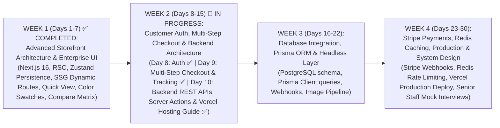

# 📌 30-Day Accelerated Full-Stack Engineering Mastery: Pinned Course Notes & Progress Tracker

> **Target Title:** Senior Frontend / Full-Stack Engineer | React | Next.js | TypeScript | E-Commerce | BigCommerce | Shopify  
> **Project Location:** `D:\NOVA Project\nova-ecommerce`  
> **PDF Study Guide Location:** `D:\NOVA Project\NOVA_Course_Day1_Day2_Notes.pdf`  
> **Deployment Guide:** [`DEPLOYMENT_AND_BACKEND_GUIDE.md`](file:///D:/NOVA%20Project/nova-ecommerce/DEPLOYMENT_AND_BACKEND_GUIDE.md)

---

## 🎯 30-Day Fast-Track Transformation Roadmap (1-Month Intensive)

---

## 🗺️ Codebase Architecture & System Dependency Diagram

```mermaid
flowchart TD
    subgraph Data & Contracts Layer
        Types["types/product.ts & types/auth.ts<br/>(Product, User, Order, ShippingTier, PaymentInfo, Review, Toast Interfaces)"]
        Data["data/products.ts<br/>(8 Flagship Products, Color Finishes, Specs, Verified Reviews & Lookup Utilities)"]
    end

    subgraph Backend APIs & Server Actions Layer
        ApiProducts["app/api/products/route.ts<br/>(GET: Search, Filter, Sort & Cache-Control REST API)"]
        ApiProductSlug["app/api/products/[slug]/route.ts<br/>(GET: Single Product by Slug with 404 Response)"]
        ApiOrders["app/api/orders/route.ts<br/>(POST: Zero-Trust Server Recalculation, Anti-Tamper & Order Creation)"]
        ServerActions["app/actions/orderActions.ts<br/>('use server' Direct Server Actions for Orders & Newsletters)"]
    end

    subgraph Global State Layer
        CartStore["store/useCartStore.ts<br/>(Zustand + Persist: Cart Items, Discounts, Toast Alerts, Shipping Calculations)"]
        WishlistStore["store/useWishlistStore.ts<br/>(Zustand + Persist: Saved Favorites, Heart Toggles, Session Storage)"]
        CompareStore["store/useCompareStore.ts<br/>(Zustand + Persist: Side-by-Side Product Comparison Matrix & Limit Gates)"]
        RecentlyViewedStore["store/useRecentlyViewedStore.ts<br/>(Zustand + Persist: Browsing History Array & Deduplication Engine)"]
        QuickViewStore["store/useQuickViewStore.ts<br/>(Zustand: Quick View Active Product & Modal Visibility State)"]
        AuthStore["store/useAuthStore.ts<br/>(Zustand + Persist: User Session, Loyalty Tier & Real Order History Receipts)"]
    end

    subgraph UI Overlays & Feedback Layer
        Toast["components/ui/Toast.tsx<br/>(Global Interactive Toast Notification Alert)"]
        CartDrawer["components/cart/CartDrawer.tsx<br/>(Slide-Over Bag, Free Shipping Progress Bar, Checkout Trigger)"]
        WishlistDrawer["components/wishlist/WishlistDrawer.tsx<br/>(Slide-Over Saved Favorites Drawer & Move-to-Bag CTAs)"]
        AuthModal["components/auth/AuthModal.tsx<br/>(Sign In & Register Modal with 1-Click Demo Login)"]
        AccountDrawer["components/auth/AccountDrawer.tsx<br/>(Customer Profile Summary, Past Receipts & Direct Order Tracking Links)"]
        CompareDrawer["components/compare/ProductCompareDrawer.tsx<br/>(Multi-Product Specs Matrix & Sticky Bottom Floating Dock)"]
        QuickViewModal["components/catalog/QuickViewModal.tsx<br/>(Interactive Quick View Inspection Modal & Color Swatches)"]
        SearchModal["components/catalog/SearchModal.tsx<br/>(Command-K ⌘K Live Quick Search Modal & Instant Previews)"]
        CheckoutModal["components/checkout/CheckoutModal.tsx<br/>(Enterprise 3-Step Guided Checkout: Connected to POST /api/orders)"]
    end

    subgraph Dynamic Order Tracking & Views
        OrderTrackingView["components/orders/OrderTrackingView.tsx<br/>(4-Stage Milestone Stepper, Carrier Tracking, Destination, Invoice & Print Trigger)"]
        OrderTrackingPage["app/orders/[orderNumber]/page.tsx<br/>(Next.js 16 Dynamic Server Route - Unwraps await params)"]
    end

    subgraph Catalog & Interactive UI Layer
        Header["components/layout/Header.tsx<br/>(Sticky Glassmorphism Navbar, Customer Avatar, Search Trigger & Triple Counter Badges)"]
        FilterBar["components/catalog/FilterBar.tsx<br/>(Search Input, Category Pills, Price/Rating Sort Selector)"]
        HeroSection["components/home/HeroSection.tsx<br/>(Flagship Hardware Reveal Banner & Interactive CTAs)"]
        ProductCard["components/home/ProductCard.tsx<br/>(Card UI, Quick View Hover, Swatches, Heart & Compare Toggles)"]
        ColorSwatchPicker["components/product/ColorSwatchPicker.tsx<br/>(Hardware Finish Selector Dots & Controlled Active Rings)"]
        ProductReviews["components/product/ProductReviews.tsx<br/>(Rating Distribution Bar Chart, Verified Reviews & Submission Form)"]
        RecentlyViewedSection["components/home/RecentlyViewedSection.tsx<br/>(Dynamic Browsing History Carousel & Clear Action)"]
        AddToCartBtn["components/product/AddToCartButton.tsx<br/>(PDP Quantity Stepper, Color Swatches, History Logger & Toast Trigger)"]
    end

    subgraph Server Routes Layer
        Home["app/page.tsx<br/>(Home Route '/' - Server Component Composition)"]
        PDP["app/products/[slug]/page.tsx<br/>(Dynamic Route - generateStaticParams SSG, Reviews & History)"]
        CategoryPage["app/categories/[slug]/page.tsx<br/>(Dynamic Category Department Route - generateStaticParams SSG)"]
    end

    Types --> Data
    Data --> ApiProducts
    Data --> ApiProductSlug
    Data --> ApiOrders
    Data --> ServerActions
    CheckoutModal -->|POST HTTP Request| ApiOrders
    CheckoutModal -->|RPC Server Action| ServerActions
    AuthStore --> Header
    AuthStore --> AuthModal
    AuthStore --> AccountDrawer
    AuthStore --> CheckoutModal
    AuthStore --> OrderTrackingView
    CartStore --> Header
    CartStore --> CartDrawer
    CartStore --> Toast
    CartStore --> ProductCard
    OrderTrackingPage --> OrderTrackingView
    CheckoutModal --> OrderTrackingPage
    AccountDrawer --> OrderTrackingPage
    Home --> Header
    Home --> Toast
    Home --> CartDrawer
    Home --> WishlistDrawer
    Home --> CompareDrawer
    Home --> QuickViewModal
    Home --> AuthModal
    Home --> AccountDrawer
    Home --> SearchModal
    Home --> CheckoutModal
    PDP --> Header
    PDP --> Toast
    PDP --> CartDrawer
    PDP --> WishlistDrawer
    PDP --> CompareDrawer
    PDP --> QuickViewModal
    PDP --> AuthModal
    PDP --> AccountDrawer
    PDP --> SearchModal
    PDP --> CheckoutModal
    PDP --> ProductReviews
    PDP --> AddToCartBtn
    PDP --> ProductCard
    PDP --> RecentlyViewedSection
    CategoryPage --> Header
    CategoryPage --> Toast
    CategoryPage --> CartDrawer
    CategoryPage --> WishlistDrawer
    CategoryPage --> CompareDrawer
    CategoryPage --> QuickViewModal
    CategoryPage --> AuthModal
    CategoryPage --> AccountDrawer
    CategoryPage --> SearchModal
    CategoryPage --> CheckoutModal
    CategoryPage --> FeaturedProducts
```

---

## 📖 Recommended File Study Order (For Beginners & Advanced Learners)

Follow this 20-step sequence when opening files in VS Code to learn the full-stack codebase:

1. **[DEPLOYMENT_AND_BACKEND_GUIDE.md](file:///D:/NOVA%20Project/nova-ecommerce/DEPLOYMENT_AND_BACKEND_GUIDE.md):** Read the master mental model explaining how the frontend browser talks to backend servers, how APIs work, and how to host on Vercel for free.
2. **[app/api/products/route.ts](file:///D:/NOVA%20Project/nova-ecommerce/app/api/products/route.ts):** Study RESTful Route Handlers — learn how `searchParams` parses query strings (`?search=...&sort=...`) and sends JSON with cache headers.
3. **[app/api/products/[slug]/route.ts](file:///D:/NOVA%20Project/nova-ecommerce/app/api/products/%5Bslug%5D/route.ts):** Learn how dynamic route segments (`[slug]`) work in Next.js 16 Route Handlers via `await context.params`.
4. **[app/api/orders/route.ts](file:///D:/NOVA%20Project/nova-ecommerce/app/api/orders/route.ts):** Study **Zero-Trust Server Security** — see why the server MUST recalculate item prices, compute real sales tax, and generate order IDs rather than trusting client inputs.
5. **[app/actions/orderActions.ts](file:///D:/NOVA%20Project/nova-ecommerce/app/actions/orderActions.ts):** Master modern Next.js 16 / React 19 Server Actions (`"use server"`) and direct RPC server function execution.
6. **[components/checkout/CheckoutModal.tsx](file:///D:/NOVA%20Project/nova-ecommerce/components/checkout/CheckoutModal.tsx):** Study how client-side form submissions dispatch real `POST` HTTP requests to `/api/orders` with error handling and fallback recovery.
7. **[components/orders/OrderTrackingView.tsx](file:///D:/NOVA%20Project/nova-ecommerce/components/orders/OrderTrackingView.tsx):** Study the 4-stage fulfillment milestone stepper, carrier tracking codes, recipient cards, and browser print triggers (`window.print()`).
8. **[app/orders/[orderNumber]/page.tsx](file:///D:/NOVA%20Project/nova-ecommerce/app/orders/[orderNumber]/page.tsx):** Study Next.js 16 dynamic route parameter unwrapping (`await params`) and server component composition.
9. **[types/auth.ts](file:///D:/NOVA%20Project/nova-ecommerce/types/auth.ts):** Study customer authentication and multi-step order contracts (`User`, `ShippingTier`, `PaymentInfo`, `Order`, `OrderStatus`).
10. **[store/useAuthStore.ts](file:///D:/NOVA%20Project/nova-ecommerce/store/useAuthStore.ts):** Learn how user sessions and order invoice receipts are saved in `localStorage`.
11. **[components/auth/AccountDrawer.tsx](file:///D:/NOVA%20Project/nova-ecommerce/components/auth/AccountDrawer.tsx):** Study the customer slide-over drawer displaying member badges, order status pills ("Delivered" / "Processing"), and direct links to `/orders/[orderNumber]`.
12. **[components/auth/AuthModal.tsx](file:///D:/NOVA%20Project/nova-ecommerce/components/auth/AuthModal.tsx):** Study login and registration tabs, validation, and 1-click demo login handling.
13. **[components/layout/Header.tsx](file:///D:/NOVA%20Project/nova-ecommerce/components/layout/Header.tsx):** Learn how the navbar switches dynamically between "Sign In" and the user's avatar initials.
14. **[components/layout/ClientOverlays.tsx](file:///D:/NOVA%20Project/nova-ecommerce/components/layout/ClientOverlays.tsx):** See how `AuthModal`, `AccountDrawer`, and `CheckoutModal` are mounted cleanly alongside Cart and Wishlist overlays.
15. **[types/product.ts](file:///D:/NOVA%20Project/nova-ecommerce/types/product.ts):** Study TypeScript blueprints — learn what an `interface` is, what optional `?` fields mean, and how data contracts prevent runtime bugs.
16. **[data/products.ts](file:///D:/NOVA%20Project/nova-ecommerce/data/products.ts):** Study our mock in-memory database — see how 8 products, color finishes, and specs are queried using `.find()` and `.filter()`.
17. **[store/useRecentlyViewedStore.ts](file:///D:/NOVA%20Project/nova-ecommerce/store/useRecentlyViewedStore.ts):** Learn how browsing history is recorded, deduplicated, and persisted to browser `localStorage`.
18. **[store/useQuickViewStore.ts](file:///D:/NOVA%20Project/nova-ecommerce/store/useQuickViewStore.ts):** Learn how lightweight Zustand stores coordinate modal popups across unrelated components.
19. **[components/product/ColorSwatchPicker.tsx](file:///D:/NOVA%20Project/nova-ecommerce/components/product/ColorSwatchPicker.tsx):** Study controlled React components and "Lifting State Up" when selecting color variants.
20. **[components/home/ProductCard.tsx](file:///D:/NOVA%20Project/nova-ecommerce/components/home/ProductCard.tsx):** Study how `e.preventDefault()` halts parent `<Link>` navigation when clicking Quick View, Compare, Wishlist, or Add to Bag.

---

## 📓 Daily Progress Log

### ✅ Week 1 (Days 1–7): Foundation, Enterprise Architecture & UI
- Built Next.js 16 App Router foundation, RSC, Zustand persistence, dynamic SSG routes, verified reviews, Command-K search, specs comparison matrix, and Quick View modal system.

### ✅ Day 8: Customer Authentication, Session State & Order History Receipts (Week 2 Kickoff)
- Created `types/auth.ts`, `store/useAuthStore.ts`, `AuthModal.tsx`, `AccountDrawer.tsx`, and integrated authentication with cart checkout and header avatar initials.

### ✅ Day 9: Multi-Step Checkout Engine & Dynamic Order Tracking Route
- Extended order contracts, built 3-step checkout state machine (`Address ➔ Delivery Speed ➔ Payment & Review`), created `/orders/[orderNumber]` dynamic route, 4-stage fulfillment milestone stepper, and invoice print functionality.

### ✅ Day 10: Full-Stack Backend Architecture — Next.js Route Handlers, Server Actions & Production Hosting
- **RESTful Catalog Route Handler (`app/api/products/route.ts`):** Created GET endpoint with search, category filtering, price/rating sorting, and `Cache-Control` CDN headers.
- **Dynamic Product Slug Route Handler (`app/api/products/[slug]/route.ts`):** Created GET endpoint unwrapping Next.js 16 async `context.params` with 404 error handling.
- **Zero-Trust Secure Order API (`app/api/orders/route.ts`):** Created POST endpoint that re-verifies prices against the server database to prevent client tampering, computes verified sales tax (8%), generates carrier tracking codes, and returns HTTP 201 Created.
- **React 19 / Next.js 16 Server Actions (`app/actions/orderActions.ts`):** Built `"use server"` actions for checkout mutations and newsletter form handling without manual REST boilerplate.
- **Frontend-to-Backend Integration (`CheckoutModal.tsx`):** Updated checkout form to dispatch real `POST /api/orders` HTTP network calls with offline fallback recovery.
- **Master Deployment & Backend Guide (`DEPLOYMENT_AND_BACKEND_GUIDE.md`):** Authored an exhaustive full-stack manual covering client vs server mental models, Vercel Git-integrated hosting (free), environment variables, serverless functions, and Docker containers.

---

## 💡 Senior Technical Interview Reference

> **Q1: Why should an e-commerce backend never trust item prices sent from the client-side checkout form?**  
> *Answer:* Client-side state lives in an untrusted environment (the user's browser). Anyone can inspect DevTools or modify HTTP request payloads to alter an item's price (e.g. changing \$299 to \$0.01). A secure backend must treat all incoming prices as zero-trust, look up each product ID in the server database, recompute verified totals and sales taxes on the server, and only authorize the verified server amount.

> **Q2: What is the architectural difference between Next.js Route Handlers (`route.ts`) and Server Actions (`"use server"`)?**  
> *Answer:* Route Handlers expose standard HTTP REST endpoints (GET, POST, PUT, DELETE) that return JSON via `NextResponse.json()`. They are essential for public APIs, mobile apps, and webhooks. Server Actions, on the other hand, are RPC (Remote Procedure Call) functions executed on the server and callable directly from React components. They eliminate boilerplate fetch calls, provide automatic end-to-end TypeScript safety, and integrate with React 19 form actions.

> **Q3: How does Vercel host a Next.js application differently from a traditional Node.js Express server?**  
> *Answer:* A traditional Express server runs as a continuous long-lived process on a single machine (e.g. EC2/VPS). Vercel uses a **hybrid serverless architecture**: static pages and client assets are pre-rendered at build time and cached across a global Edge CDN, while dynamic API routes and Server Actions are compiled into isolated **Serverless Functions** (AWS Lambda). These functions spin up on demand in milliseconds, scale horizontally to handle traffic spikes, and scale down to zero when idle with zero maintenance overhead.
