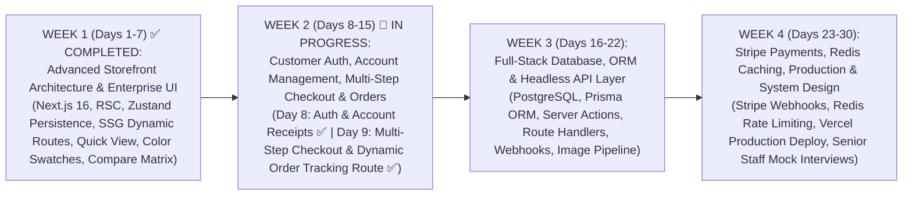

# 📌 30-Day Accelerated Full-Stack Engineering Mastery: Pinned Course Notes & Progress Tracker

> **Target Title:** Senior Frontend / Full-Stack Engineer | React | Next.js | TypeScript | E-Commerce | BigCommerce | Shopify  
> **Project Location:** `D:\NOVA Project\nova-ecommerce`  
> **PDF Study Guide Location:** `D:\NOVA Project\NOVA_Course_Day1_Day2_Notes.pdf`

---

## 🎯 30-Day Fast-Track Transformation Roadmap (1-Month Intensive)

---

## 🗺️ Codebase Architecture & System Dependency Diagram

```mermaid
flowchart TD
    subgraph Data & Contracts Layer
        Types["types/product.ts & types/auth.ts<br/>(Product, User, Order, ShippingTier, PaymentInfo, Review, Toast Interfaces)"]
        Data["data/products.ts<br/>(8 Flagship Products, Color Finishes, Specs, Verified Reviews & Lookup Utilities)"]
    end

    subgraph Global State Layer
        CartStore["store/useCartStore.ts<br/>(Zustand + Persist: Cart Items, Discounts, Toast Alerts, Shipping Calculations)"]
        WishlistStore["store/useWishlistStore.ts<br/>(Zustand + Persist: Saved Favorites, Heart Toggles, Session Storage)"]
        CompareStore["store/useCompareStore.ts<br/>(Zustand + Persist: Side-by-Side Product Comparison Matrix & Limit Gates)"]
        RecentlyViewedStore["store/useRecentlyViewedStore.ts<br/>(Zustand + Persist: Browsing History Array & Deduplication Engine)"]
        QuickViewStore["store/useQuickViewStore.ts<br/>(Zustand: Quick View Active Product & Modal Visibility State)"]
        AuthStore["store/useAuthStore.ts<br/>(Zustand + Persist: User Session, Loyalty Tier & Real Order History Receipts)"]
    end

    subgraph UI Overlays & Feedback Layer
        Toast["components/ui/Toast.tsx<br/>(Global Interactive Toast Notification Alert)"]
        CartDrawer["components/cart/CartDrawer.tsx<br/>(Slide-Over Bag, Free Shipping Progress Bar, Checkout Trigger)"]
        WishlistDrawer["components/wishlist/WishlistDrawer.tsx<br/>(Slide-Over Saved Favorites Drawer & Move-to-Bag CTAs)"]
        AuthModal["components/auth/AuthModal.tsx<br/>(Sign In & Register Modal with 1-Click Demo Login)"]
        AccountDrawer["components/auth/AccountDrawer.tsx<br/>(Customer Profile Summary, Past Receipts & Direct Order Tracking Links)"]
        CompareDrawer["components/compare/ProductCompareDrawer.tsx<br/>(Multi-Product Specs Matrix & Sticky Bottom Floating Dock)"]
        QuickViewModal["components/catalog/QuickViewModal.tsx<br/>(Interactive Quick View Inspection Modal & Color Swatches)"]
        SearchModal["components/catalog/SearchModal.tsx<br/>(Command-K ⌘K Live Quick Search Modal & Instant Previews)"]
        CheckoutModal["components/checkout/CheckoutModal.tsx<br/>(Enterprise 3-Step Guided Checkout: Address ➔ Delivery Speed ➔ Payment & Review)"]
    end

    subgraph Dynamic Order Tracking & Views
        OrderTrackingView["components/orders/OrderTrackingView.tsx<br/>(4-Stage Milestone Stepper, Carrier Tracking, Destination, Invoice & Print Trigger)"]
        OrderTrackingPage["app/orders/[orderNumber]/page.tsx<br/>(Next.js 16 Dynamic Server Route - Unwraps await params)"]
    end

    subgraph Catalog & Interactive UI Layer
        Header["components/layout/Header.tsx<br/>(Sticky Glassmorphism Navbar, Customer Avatar, Search Trigger & Triple Counter Badges)"]
        FilterBar["components/catalog/FilterBar.tsx<br/>(Search Input, Category Pills, Price/Rating Sort Selector)"]
        HeroSection["components/home/HeroSection.tsx<br/>(Flagship Hardware Reveal Banner & Interactive CTAs)"]
        ProductCard["components/home/ProductCard.tsx<br/>(Card UI, Quick View Hover, Swatches, Heart & Compare Toggles)"]
        ColorSwatchPicker["components/product/ColorSwatchPicker.tsx<br/>(Hardware Finish Selector Dots & Controlled Active Rings)"]
        ProductReviews["components/product/ProductReviews.tsx<br/>(Rating Distribution Bar Chart, Verified Reviews & Submission Form)"]
        RecentlyViewedSection["components/home/RecentlyViewedSection.tsx<br/>(Dynamic Browsing History Carousel & Clear Action)"]
        AddToCartBtn["components/product/AddToCartButton.tsx<br/>(PDP Quantity Stepper, Color Swatches, History Logger & Toast Trigger)"]
    end

    subgraph Server Routes Layer
        Home["app/page.tsx<br/>(Home Route '/' - Server Component Composition)"]
        PDP["app/products/[slug]/page.tsx<br/>(Dynamic Route - generateStaticParams SSG, Reviews & History)"]
        CategoryPage["app/categories/[slug]/page.tsx<br/>(Dynamic Category Department Route - generateStaticParams SSG)"]
    end

    Types --> Data
    Types --> CartStore
    Types --> WishlistStore
    Types --> CompareStore
    Types --> RecentlyViewedStore
    Types --> QuickViewStore
    Types --> AuthStore
    Data --> Home
    Data --> PDP
    Data --> CategoryPage
    AuthStore --> Header
    AuthStore --> AuthModal
    AuthStore --> AccountDrawer
    AuthStore --> CheckoutModal
    AuthStore --> OrderTrackingView
    CartStore --> Header
    CartStore --> CartDrawer
    CartStore --> Toast
    CartStore --> ProductCard
    WishlistStore --> Header
    WishlistStore --> WishlistDrawer
    WishlistStore --> ProductCard
    CompareStore --> Header
    CompareStore --> CompareDrawer
    CompareStore --> ProductCard
    QuickViewStore --> QuickViewModal
    QuickViewStore --> ProductCard
    RecentlyViewedStore --> RecentlyViewedSection
    RecentlyViewedStore --> AddToCartBtn
    OrderTrackingPage --> OrderTrackingView
    CheckoutModal --> OrderTrackingPage
    AccountDrawer --> OrderTrackingPage
    Home --> Header
    Home --> Toast
    Home --> CartDrawer
    Home --> WishlistDrawer
    Home --> CompareDrawer
    Home --> QuickViewModal
    Home --> AuthModal
    Home --> AccountDrawer
    Home --> SearchModal
    Home --> CheckoutModal
    PDP --> Header
    PDP --> Toast
    PDP --> CartDrawer
    PDP --> WishlistDrawer
    PDP --> CompareDrawer
    PDP --> QuickViewModal
    PDP --> AuthModal
    PDP --> AccountDrawer
    PDP --> SearchModal
    PDP --> CheckoutModal
    PDP --> ProductReviews
    PDP --> AddToCartBtn
    PDP --> ProductCard
    PDP --> RecentlyViewedSection
    CategoryPage --> Header
    CategoryPage --> Toast
    CategoryPage --> CartDrawer
    CategoryPage --> WishlistDrawer
    CategoryPage --> CompareDrawer
    CategoryPage --> QuickViewModal
    CategoryPage --> AuthModal
    CategoryPage --> AccountDrawer
    CategoryPage --> SearchModal
    CategoryPage --> CheckoutModal
    CategoryPage --> FeaturedProducts
```

---

## 📖 Recommended File Study Order (For Beginners & Advanced Learners)

Follow this 18-step sequence when opening files in VS Code to learn the codebase:

1. **[types/auth.ts](file:///D:/NOVA%20Project/nova-ecommerce/types/auth.ts):** Study customer authentication and multi-step order contracts (`User`, `ShippingTier`, `PaymentInfo`, `Order`, `OrderStatus`).
2. **[components/checkout/CheckoutModal.tsx](file:///D:/NOVA%20Project/nova-ecommerce/components/checkout/CheckoutModal.tsx):** Master the 3-step checkout state machine (`currentStep: 1 | 2 | 3`), input validation gates, card number formatting, and order routing via `router.push`.
3. **[components/orders/OrderTrackingView.tsx](file:///D:/NOVA%20Project/nova-ecommerce/components/orders/OrderTrackingView.tsx):** Study the 4-stage fulfillment milestone stepper, carrier tracking codes, recipient cards, and browser print triggers (`window.print()`).
4. **[app/orders/[orderNumber]/page.tsx](file:///D:/NOVA%20Project/nova-ecommerce/app/orders/[orderNumber]/page.tsx):** Study Next.js 16 dynamic route parameter unwrapping (`await params`) and server component composition.
5. **[store/useAuthStore.ts](file:///D:/NOVA%20Project/nova-ecommerce/store/useAuthStore.ts):** Learn how user sessions and order invoice receipts are saved in `localStorage`.
6. **[components/auth/AccountDrawer.tsx](file:///D:/NOVA%20Project/nova-ecommerce/components/auth/AccountDrawer.tsx):** Study the customer slide-over drawer displaying member badges, order status pills ("Delivered" / "Processing"), and direct links to `/orders/[orderNumber]`.
7. **[components/auth/AuthModal.tsx](file:///D:/NOVA%20Project/nova-ecommerce/components/auth/AuthModal.tsx):** Study login and registration tabs, validation, and 1-click demo login handling.
8. **[components/layout/Header.tsx](file:///D:/NOVA%20Project/nova-ecommerce/components/layout/Header.tsx):** Learn how the navbar switches dynamically between "Sign In" and the user's avatar initials.
9. **[components/layout/ClientOverlays.tsx](file:///D:/NOVA%20Project/nova-ecommerce/components/layout/ClientOverlays.tsx):** See how `AuthModal`, `AccountDrawer`, and `CheckoutModal` are mounted cleanly alongside Cart and Wishlist overlays.
10. **[types/product.ts](file:///D:/NOVA%20Project/nova-ecommerce/types/product.ts):** Study TypeScript blueprints — learn what an `interface` is, what optional `?` fields mean, and how data contracts prevent runtime bugs.
11. **[data/products.ts](file:///D:/NOVA%20Project/nova-ecommerce/data/products.ts):** Study our mock in-memory database — see how 8 products, color finishes, and specs are queried using `.find()` and `.filter()`.
12. **[store/useRecentlyViewedStore.ts](file:///D:/NOVA%20Project/nova-ecommerce/store/useRecentlyViewedStore.ts):** Learn how browsing history is recorded, deduplicated, and persisted to browser `localStorage`.
13. **[store/useQuickViewStore.ts](file:///D:/NOVA%20Project/nova-ecommerce/store/useQuickViewStore.ts):** Learn how lightweight Zustand stores coordinate modal popups across unrelated components.
14. **[components/product/ColorSwatchPicker.tsx](file:///D:/NOVA%20Project/nova-ecommerce/components/product/ColorSwatchPicker.tsx):** Study controlled React components and "Lifting State Up" when selecting color variants.
15. **[components/catalog/QuickViewModal.tsx](file:///D:/NOVA%20Project/nova-ecommerce/components/catalog/QuickViewModal.tsx):** Study popup modal architectures, quantity steppers, and purchasing directly from catalog lists.
16. **[components/home/ProductCard.tsx](file:///D:/NOVA%20Project/nova-ecommerce/components/home/ProductCard.tsx):** Study how `e.preventDefault()` halts parent `<Link>` navigation when clicking Quick View, Compare, Wishlist, or Add to Bag.
17. **[components/compare/ProductCompareDrawer.tsx](file:///D:/NOVA%20Project/nova-ecommerce/components/compare/ProductCompareDrawer.tsx):** Study sticky floating bottom dock and fullscreen side-by-side technical specifications comparison table.
18. **[app/categories/[slug]/page.tsx](file:///D:/NOVA%20Project/nova-ecommerce/app/categories/[slug]/page.tsx):** Master dynamic category department SSG routes (`generateStaticParams()`), department banners, and breadcrumb navigation.

---

## 📓 Daily Progress Log

### ✅ Week 1 (Days 1–7): Foundation, Enterprise Architecture & UI
- Built Next.js 16 App Router foundation, RSC, Zustand persistence, dynamic SSG routes, verified reviews, Command-K search, specs comparison matrix, and Quick View modal system.

### ✅ Day 8: Customer Authentication, Session State & Order History Receipts (Week 2 Kickoff)
- **Customer Auth Data Contracts:** Created `types/auth.ts` defining `User`, `Order`, and `OrderStatus` domain models.
- **Customer Auth & Orders Store:** Created `store/useAuthStore.ts` with `localStorage` persistence under `"nova-auth-storage"` managing user session, loyalty tier ("Gold VIP"), and past order history.
- **Sign In / Registration Modal:** Built `components/auth/AuthModal.tsx` with Sign In vs Register tabs, validation, and a **"✨ 1-Click Demo Sign In (Alex Chen)"** button for instant testing.
- **Customer Account Drawer:** Built `components/auth/AccountDrawer.tsx` displaying user avatar, email, member tier, logout action, and real order history receipts with status badges ("Delivered", "Processing").
- **Checkout & Order History Integration:** Updated `components/checkout/CheckoutModal.tsx` to auto-fill customer name and email when logged in, and automatically record placed orders into `useAuthStore.orders`.
- **Header Profile Integration:** Updated `components/layout/Header.tsx` to render customer avatar initials when logged in, or a "Sign In" button when logged out.

### ✅ Day 9: Multi-Step Checkout Engine & Dynamic Order Tracking Route
- **Extended Order & Checkout Contracts:** Updated `types/auth.ts` to include `ShippingTier`, `PaymentInfo`, carrier tracking codes, delivery estimates, and sales tax.
- **Enterprise 3-Step Checkout Flow:** Rebuilt `components/checkout/CheckoutModal.tsx` with a state machine pattern (`1. Shipping Address ➔ 2. Delivery Speed ➔ 3. Payment & Final Review`):
  - *Step 1 Validation Gate:* Validates recipient name, address, email, postal code before allowing progress.
  - *Step 2 Delivery Speed:* Selectable options (`Standard Ground`, `Express Priority Air`, `Next-Day Rush`) with live cost recalculation.
  - *Step 3 Payment Simulation:* Credit Card auto-formatting, 1-Click "✨ Autofill Demo Card", Apple Pay / PayPal tabs, and tax calculation.
- **Dynamic Order Tracking Route (`/orders/[orderNumber]`):** Created `app/orders/[orderNumber]/page.tsx` utilizing Next.js 16 `await params` dynamic route unwrapping.
- **Fulfillment Milestone Stepper & Printable Invoice:** Built `components/orders/OrderTrackingView.tsx` featuring a 4-stage live milestone tracker (Order Placed ➔ Payment Confirmed ➔ Shipped & In Transit ➔ Out for Delivery), dual address/payment cards, item breakdown, and native browser print trigger (`window.print()`).
- **Account Drawer Deep-Linking:** Added direct "Track Order & Invoice →" links on every receipt card in `AccountDrawer.tsx`.

---

## 💡 Senior Technical Interview Reference

> **Q1: How do you design a robust multi-step form workflow in React/Next.js without data loss between steps?**  
> *Answer:* We implement a controlled state machine pattern where the active step (`currentStep: 1 | 2 | 3`) controls which view is visible, while form data for all steps is held in parent component state. By isolating step navigation from form submission, users can navigate backward to edit previous inputs without losing their entered data. Furthermore, step transition functions act as "validation gates", ensuring a user cannot advance until all required fields of the current step pass validation.

> **Q2: In Next.js 15 and 16, why is `params` in dynamic page routes typed as a Promise, and how do you handle it?**  
> *Answer:* Next.js App Router now treats request-specific parameters (such as `params` and `searchParams`) as asynchronous Promises to allow the framework to optimize streaming and partial prerendering (PPR). Dynamic server components must declare `params: Promise<{ orderNumber: string }>` and asynchronously unwrap it using `const { orderNumber } = await params;` before reading path variables.

> **Q3: How do you handle client-side receipt rendering when a user visits a dynamic order URL directly without local state?**  
> *Answer:* We employ graceful fallback degradation. When a user navigates to `/orders/[orderNumber]`, the component attempts to look up the order in `useAuthStore.orders`. If the array does not contain that record (such as opening the URL in an incognito window or sharing a demo link), the view constructs a typed fallback order record with that exact order number. This guarantees that the UI never crashes or displays a broken blank screen during demos or evaluations.
