# 📌 Full-Stack AI Application Engineering Mastery: Pinned Course Notes & Career Tracker

> **Target Professional Profile:** AI Application Engineer with Full-Stack & Cloud Expertise  
> **Two-Project Career Roadmap:**  
> • **Project 1 (Current):** `NOVA Storefront` — Production-grade Full-Stack Headless Commerce with Next.js 16, TypeScript, Node.js APIs, PostgreSQL, Redis, Grounded RAG Copilot, Tool Calling, Docker & AWS/Vercel.  
> • **Project 2 (Next):** `Enterprise Multi-Agent Platform` — Complex distributed architecture with Python (FastAPI), pgvector embeddings, asynchronous Redis queues, and enterprise cloud observability.  
>
> **The 6 Master Pillars of Your Career Training:**  
> `01.` **TypeScript + React + Next.js:** Build production-quality user interfaces and web applications.  
> `02.` **Node.js + Python + APIs:** Build backend services and integrate external systems and AI models.  
> `03.` **PostgreSQL + Redis + Queues:** Manage data, caching, background tasks, and reliable workflows.  
> `04.` **LLMs + RAG + Tool Calling:** Build AI features grounded in real data with controlled actions and evaluation.  
> `05.` **AWS + Docker + CI/CD:** Deploy, secure, monitor, and scale your applications.  
> `06.` **System Design + Security + Testing:** Make the whole application reliable, maintainable, and safe.  
>
> **Project Location:** `D:\NOVA Project\nova-ecommerce`  
> **Deployment Guide:** [`DEPLOYMENT_AND_BACKEND_GUIDE.md`](file:///D:/NOVA%20Project/nova-ecommerce/DEPLOYMENT_AND_BACKEND_GUIDE.md)

---

## 🎯 4-Phase Foundation-First Engineering Roadmap

> **Core Philosophy:** "Strong fundamentals will help you build, debug, and verify AI-generated applications. Upgrade from a frontend developer who implements UI to an engineer who understands the whole application."

```mermaid
flowchart TD
    P1["PHASE 1: Core Frontend & TypeScript Engineering (Active)
    - JavaScript: Promises, async/await, event loop, closures, array methods
    - TypeScript: Generics, interfaces, type narrowing, discriminated unions
    - React: Custom hooks, render cycles, reconciliation, stale closures, loading/error states
    - Goal: Build and debug frontend architectures without copying blindly"]
    
    P2["PHASE 2: Next.js & Full-Stack Backend Fundamentals
    - Next.js 16: App Router, RSC vs RCC boundaries, caching & revalidation
    - Backend: Route Handlers, Server Actions, HTTP status codes, security
    - Database: PostgreSQL, Prisma ORM, migrations, schema modeling
    - Goal: Build, validate, and secure a complete full-stack web application"]
    
    P3["PHASE 3: Applied AI & LLM Systems Engineering
    - LLM Integrations: Secure backend API proxies (OpenAI/Gemini/Anthropic)
    - Tool Calling & Structured Outputs: JSON schemas, programmatic UI actions
    - Grounded RAG: Semantic retrieval from database/documents, hallucination prevention
    - Goal: Build dependable, observable AI features you can test and debug"]
    
    P4["PHASE 4: Cloud-Native AWS & Production DevOps
    - Infrastructure: Docker containers, AWS deployment, serverless edge networks
    - Production: CI/CD pipelines, logging, monitoring, performance profiling
    - Goal: Operate, scale, and troubleshoot production applications reliably"]

    P1 --> P2
    P2 --> P3
    P3 --> P4
```



---

## 🗺️ Codebase Architecture & System Dependency Diagram

```mermaid
flowchart TD
    subgraph Data & Contracts Layer
        Types["types/product.ts, types/auth.ts & types/ai.ts<br/>(Product, User, Order, ChatMessage, AIToolCall, AISuggestedAction)"]
        Data["data/products.ts<br/>(8 Flagship Products, Color Finishes, Specs, Verified Reviews & Lookup Utilities)"]
    end

    subgraph Backend APIs, AI RAG & Server Actions Layer
        ApiAI["app/api/ai/chat/route.ts<br/>(POST: Semantic RAG Retrieval, Autonomous Tool Calling & Structured Action Synthesis)"]
        ApiProducts["app/api/products/route.ts<br/>(GET: Search, Filter, Sort & Cache-Control REST API)"]
        ApiProductSlug["app/api/products/[slug]/route.ts<br/>(GET: Single Product by Slug with 404 Response)"]
        ApiOrders["app/api/orders/route.ts<br/>(POST: Zero-Trust Server Recalculation, Anti-Tamper & Order Creation)"]
        ServerActions["app/actions/orderActions.ts<br/>('use server' Direct Server Actions for Orders & Newsletters)"]
    end

    subgraph Global State Layer
        AIStore["store/useAIStore.ts<br/>(Zustand + Persist: AI Chat Stream, Active Product Context & RAG Dispatcher)"]
        CartStore["store/useCartStore.ts<br/>(Zustand + Persist: Cart Items, Discounts, Toast Alerts, Shipping Calculations)"]
        WishlistStore["store/useWishlistStore.ts<br/>(Zustand + Persist: Saved Favorites, Heart Toggles, Session Storage)"]
        CompareStore["store/useCompareStore.ts<br/>(Zustand + Persist: Side-by-Side Product Comparison Matrix & Limit Gates)"]
        RecentlyViewedStore["store/useRecentlyViewedStore.ts<br/>(Zustand + Persist: Browsing History Array & Deduplication Engine)"]
        QuickViewStore["store/useQuickViewStore.ts<br/>(Zustand: Quick View Active Product & Modal Visibility State)"]
        AuthStore["store/useAuthStore.ts<br/>(Zustand + Persist: User Session, Loyalty Tier & Real Order History Receipts)"]
    end

    subgraph UI Overlays & Feedback Layer
        AICopilotDrawer["components/ai/AICopilotDrawer.tsx<br/>(RAG Shopping Concierge, Tool Execution Badges, Embedded Product Cards & Action Chips)"]
        Toast["components/ui/Toast.tsx<br/>(Global Interactive Toast Notification Alert)"]
        CartDrawer["components/cart/CartDrawer.tsx<br/>(Slide-Over Bag, Free Shipping Progress Bar, Checkout Trigger)"]
        WishlistDrawer["components/wishlist/WishlistDrawer.tsx<br/>(Slide-Over Saved Favorites Drawer & Move-to-Bag CTAs)"]
        AuthModal["components/auth/AuthModal.tsx<br/>(Sign In & Register Modal with 1-Click Demo Login)"]
        AccountDrawer["components/auth/AccountDrawer.tsx<br/>(Customer Profile Summary, Past Receipts & Direct Order Tracking Links)"]
        CompareDrawer["components/compare/ProductCompareDrawer.tsx<br/>(Multi-Product Specs Matrix & Sticky Bottom Floating Dock)"]
        QuickViewModal["components/catalog/QuickViewModal.tsx<br/>(Interactive Quick View Inspection Modal & Color Swatches)"]
        SearchModal["components/catalog/SearchModal.tsx<br/>(Command-K ⌘K Live Quick Search Modal & Instant Previews)"]
        CheckoutModal["components/checkout/CheckoutModal.tsx<br/>(Enterprise 3-Step Guided Checkout: Connected to POST /api/orders)"]
    end

    subgraph Dynamic Order Tracking & Views
        OrderTrackingView["components/orders/OrderTrackingView.tsx<br/>(4-Stage Milestone Stepper, Carrier Tracking, Destination, Invoice & Print Trigger)"]
        OrderTrackingPage["app/orders/[orderNumber]/page.tsx<br/>(Next.js 16 Dynamic Server Route - Unwraps await params)"]
    end

    subgraph Catalog & Interactive UI Layer
        Header["components/layout/Header.tsx<br/>(Sticky Glassmorphism Navbar, ✨ Ask AI Trigger, Avatar & Badges)"]
        FilterBar["components/catalog/FilterBar.tsx<br/>(Search Input, Category Pills, Price/Rating Sort Selector)"]
        ProductCard["components/home/ProductCard.tsx<br/>(Card UI, Quick View Hover, Swatches, Heart & Compare Toggles)"]
        AddToCartBtn["components/product/AddToCartButton.tsx<br/>(PDP Quantity Stepper, Color Swatches, History Logger & ✨ Ask AI Product Context)"]
    end

    Types --> Data
    Data --> ApiAI
    Data --> ApiProducts
    Data --> ApiOrders
    AIStore -->|POST Request| ApiAI
    AIStore --> AICopilotDrawer
    CheckoutModal -->|POST Request| ApiOrders
    Header --> AIStore
    AddToCartBtn --> AIStore
    AICopilotDrawer --> CartStore
    AICopilotDrawer --> QuickViewStore
    AICopilotDrawer --> CompareStore
```

---

## 📖 Recommended File Study Order (For Beginners & Advanced Learners)

Follow this 22-step sequence when opening files in VS Code to learn the full-stack AI codebase:

1. **[hooks/useDebounce.ts](file:///D:/NOVA%20Project/nova-ecommerce/hooks/useDebounce.ts):** Master JavaScript closures, `setTimeout`, `useEffect` cleanup functions, and TypeScript Generics (`<T>`) to throttle network requests.
2. **[hooks/useAsync.ts](file:///D:/NOVA%20Project/nova-ecommerce/hooks/useAsync.ts):** Learn generic async state machines (`idle` | `pending` | `success` | `error`), type narrowing on errors (`err instanceof Error`), and memory leak prevention with `useRef`.
3. **[lib/apiClient.ts](file:///D:/NOVA%20Project/nova-ecommerce/lib/apiClient.ts):** Study centralized HTTP clients, custom `ApiError` class, dynamic `URLSearchParams` query construction, and `AbortSignal` race condition prevention.
4. **[components/catalog/SearchModal.tsx](file:///D:/NOVA%20Project/nova-ecommerce/components/catalog/SearchModal.tsx):** Study production-grade full-stack search integration with the 4 UI states (loading skeleton, error alert, empty state, and live success results).
5. **[types/ai.ts](file:///D:/NOVA%20Project/nova-ecommerce/types/ai.ts):** Study AI contracts — understand `ChatMessage`, `AIToolCall`, `AISuggestedAction`, and structured JSON output schemas.
2. **[app/api/ai/chat/route.ts](file:///D:/NOVA%20Project/nova-ecommerce/app/api/ai/chat/route.ts):** Master **RAG (Retrieval-Augmented Generation)** and **AI Tool Calling** — study how the backend retrieves factual database specs to prevent LLM hallucinations, and executes tools like `searchCatalog`, `compareSpecs`, and `trackOrder`.
3. **[store/useAIStore.ts](file:///D:/NOVA%20Project/nova-ecommerce/store/useAIStore.ts):** Learn how conversational AI state, message history, active product context, and generation spinners are managed with Zustand.
4. **[components/ai/AICopilotDrawer.tsx](file:///D:/NOVA%20Project/nova-ecommerce/components/ai/AICopilotDrawer.tsx):** Study AI UI engineering — see how tool execution badges, interactive product recommendation cards, and 1-click action chips are embedded in the chat stream.
5. **[DEPLOYMENT_AND_BACKEND_GUIDE.md](file:///D:/NOVA%20Project/nova-ecommerce/DEPLOYMENT_AND_BACKEND_GUIDE.md):** Read the master mental model explaining how the frontend browser talks to backend servers, how APIs work, and how to host on Vercel for free.
6. **[app/api/products/route.ts](file:///D:/NOVA%20Project/nova-ecommerce/app/api/products/route.ts):** Study RESTful Route Handlers — learn how `searchParams` parses query strings (`?search=...&sort=...`) and sends JSON with cache headers.
7. **[app/api/products/[slug]/route.ts](file:///D:/NOVA%20Project/nova-ecommerce/app/api/products/%5Bslug%5D/route.ts):** Learn how dynamic route segments (`[slug]`) work in Next.js 16 Route Handlers via `await context.params`.
8. **[app/api/orders/route.ts](file:///D:/NOVA%20Project/nova-ecommerce/app/api/orders/route.ts):** Study **Zero-Trust Server Security** — see why the server MUST recalculate item prices, compute real sales tax, and generate order IDs rather than trusting client inputs.
9. **[app/actions/orderActions.ts](file:///D:/NOVA%20Project/nova-ecommerce/app/actions/orderActions.ts):** Master modern Next.js 16 / React 19 Server Actions (`"use server"`) and direct RPC server function execution.
10. **[components/checkout/CheckoutModal.tsx](file:///D:/NOVA%20Project/nova-ecommerce/components/checkout/CheckoutModal.tsx):** Study how client-side form submissions dispatch real `POST` HTTP requests to `/api/orders` with error handling and fallback recovery.
11. **[components/orders/OrderTrackingView.tsx](file:///D:/NOVA%20Project/nova-ecommerce/components/orders/OrderTrackingView.tsx):** Study the 4-stage fulfillment milestone stepper, carrier tracking codes, recipient cards, and browser print triggers (`window.print()`).
12. **[app/orders/[orderNumber]/page.tsx](file:///D:/NOVA%20Project/nova-ecommerce/app/orders/[orderNumber]/page.tsx):** Study Next.js 16 dynamic route parameter unwrapping (`await params`) and server component composition.
13. **[types/auth.ts](file:///D:/NOVA%20Project/nova-ecommerce/types/auth.ts):** Study customer authentication and multi-step order contracts (`User`, `ShippingTier`, `PaymentInfo`, `Order`, `OrderStatus`).
14. **[store/useAuthStore.ts](file:///D:/NOVA%20Project/nova-ecommerce/store/useAuthStore.ts):** Learn how user sessions and order invoice receipts are saved in `localStorage`.
15. **[components/auth/AccountDrawer.tsx](file:///D:/NOVA%20Project/nova-ecommerce/components/auth/AccountDrawer.tsx):** Study the customer slide-over drawer displaying member badges, order status pills ("Delivered" / "Processing"), and direct links to `/orders/[orderNumber]`.
16. **[components/auth/AuthModal.tsx](file:///D:/NOVA%20Project/nova-ecommerce/components/auth/AuthModal.tsx):** Study login and registration tabs, validation, and 1-click demo login handling.
17. **[components/layout/Header.tsx](file:///D:/NOVA%20Project/nova-ecommerce/components/layout/Header.tsx):** Learn how the navbar switches dynamically between "Sign In", user avatar initials, and the `✨ Ask AI` trigger button.
18. **[components/layout/ClientOverlays.tsx](file:///D:/NOVA%20Project/nova-ecommerce/components/layout/ClientOverlays.tsx):** See how `AICopilotDrawer` is mounted cleanly alongside Cart, Wishlist, and Checkout overlays.
19. **[types/product.ts](file:///D:/NOVA%20Project/nova-ecommerce/types/product.ts):** Study TypeScript blueprints — learn what an `interface` is, what optional `?` fields mean, and how data contracts prevent runtime bugs.
20. **[data/products.ts](file:///D:/NOVA%20Project/nova-ecommerce/data/products.ts):** Study our mock in-memory database — see how 8 products, color finishes, and specs are queried using `.find()` and `.filter()`.
21. **[components/product/AddToCartButton.tsx](file:///D:/NOVA%20Project/nova-ecommerce/components/product/AddToCartButton.tsx):** Learn how the PDP mounts the "✨ Ask AI about this product" CTA to pass contextual hardware specs straight into the AI Copilot.
22. **[components/home/ProductCard.tsx](file:///D:/NOVA%20Project/nova-ecommerce/components/home/ProductCard.tsx):** Study how `e.preventDefault()` halts parent `<Link>` navigation when clicking Quick View, Compare, Wishlist, or Add to Bag.

---

## 📓 Daily Progress Log

### ✅ Week 1 (Days 1–7): Foundation, Enterprise Architecture & UI
- Built Next.js 16 App Router foundation, RSC, Zustand persistence, dynamic SSG routes, verified reviews, Command-K search, specs comparison matrix, and Quick View modal system.

### ✅ Day 8: Customer Authentication, Session State & Order History Receipts (Week 2 Kickoff)
- Created `types/auth.ts`, `store/useAuthStore.ts`, `AuthModal.tsx`, `AccountDrawer.tsx`, and integrated authentication with cart checkout and header avatar initials.

### ✅ Day 9: Multi-Step Checkout Engine & Dynamic Order Tracking Route
- Extended order contracts, built 3-step checkout state machine (`Address ➔ Delivery Speed ➔ Payment & Review`), created `/orders/[orderNumber]` dynamic route, 4-stage fulfillment milestone stepper, and invoice print functionality.

### ✅ Day 10: Full-Stack Backend Architecture — Next.js Route Handlers, Server Actions & Production Hosting
- Built RESTful catalog APIs (`/api/products`), dynamic slug APIs (`/api/products/[slug]`), zero-trust price verification order APIs (`/api/orders`), React 19 Server Actions, and authored master deployment manual (`DEPLOYMENT_AND_BACKEND_GUIDE.md`).

### ✅ Day 11: Applied AI Engineering — Headless RAG & Autonomous Tool Calling Copilot
- **AI Data Contracts (`types/ai.ts`):** Defined typed contracts for `ChatMessage`, `AIToolCall`, `AISuggestedAction`, `AIChatRequest`, and `AIChatResponse`.
- **RAG & Tool Calling Endpoint (`app/api/ai/chat/route.ts`):**
  - *Retrieval-Augmented Generation:* Implemented keyword & semantic retrieval over the product catalog to ground responses in factual inventory data, eliminating LLM hallucinations.
  - *Autonomous Tool Calling:* Created tools for `searchCatalog` (price/feature filters), `compareSpecs` (specifications comparison), `trackOrder` (real-time order milestone lookup for codes like `NV-XXXX`), and `getActivePromos` (discount code retrieval).
- **Zustand AI Session Store (`store/useAIStore.ts`):** Created persistent chat state managing message stream, loading indicators, active product context, and RAG API dispatching.
- **Headless AI Copilot Drawer (`components/ai/AICopilotDrawer.tsx`):** Built slide-over interface displaying tool execution badges, interactive embedded recommendation cards with 1-click "Add to Bag", action chips, and starter prompts.
- **Storefront & PDP AI Integrations:** Added `✨ Ask AI` copilot launcher to `Header.tsx`, mounted drawer in `ClientOverlays.tsx`, and added product context consultation button to `AddToCartButton.tsx`.

### ✅ Day 12: Core Frontend Engineering — TypeScript Generics, Custom React Hooks & Resilient 4-State API Search
- **Generic Debounce Hook (`hooks/useDebounce.ts`):** Built generic `<T>` debouncing hook to throttle network requests, explaining closures, `setTimeout`, event loop scheduling, and React `useEffect` cleanup execution.
- **Generic Async State Machine Hook (`hooks/useAsync.ts`):** Created reusable hook managing `idle` | `pending` | `success` | `error` states, type narrowing error catches (`err instanceof Error`), and preventing memory leaks via `isMountedRef`.
- **Type-Safe API Client (`lib/apiClient.ts`):** Created centralized HTTP client with custom `ApiError` class, dynamic query string builder (`URLSearchParams`), and `AbortSignal` race condition prevention.
- **Resilient Full-Stack Search Modal (`components/catalog/SearchModal.tsx`):** Connected the Command-K search bar to `fetchProductsApi` with a 300ms debounce, handling the 4 critical UI states (loading skeleton shimmer, offline/error alert, empty state with filter reset, and live server results).

---

## 💡 Senior Technical Interview Reference

> **Q1: How does a debounced custom React hook leverage JavaScript closures and effect cleanups?**  
> *Answer:* A debounce hook schedules state updates using `setTimeout(..., delay)`. Because of JavaScript closures, the timer callback retains reference to the `value` passed during that render. If the user changes `value` before the delay expires (e.g. typing another letter), React re-executes the effect. Crucially, before running the new effect, React invokes the previous effect's **cleanup function** (`clearTimeout(timerId)`), cancelling the outdated timer and ensuring only the final idle value triggers a re-render and network request.

> **Q2: Why are TypeScript Generics (`<T>`) preferred over `any` when building custom hooks and API clients?**  
> *Answer:* Using `any` completely disables the TypeScript type checker, introducing runtime crash vulnerabilities. A Generic `<T>` acts as a type variable that preserves the exact type contract through the function. If you pass a `string` to `useDebounce<string>()`, the return value is strictly typed as a `string`. If you pass a complex object or interface, TypeScript validates all properties downstream with full IDE autocompletion and compile-time verification.

> **Q3: How do you prevent network race conditions when users type into an asynchronous search bar?**  
> *Answer:* We combine two techniques:  
> 1. **Debouncing:** Pauses request dispatch until the user finishes typing (e.g. 300ms).  
> 2. **AbortController:** Before firing a new `fetch()` call, we invoke `abortController.abort()` on the previous request. If network latency causes an earlier request to arrive *after* a newer request, the browser discards the aborted response, preventing stale data from overwriting fresh search results.

> **Q1: What is Retrieval-Augmented Generation (RAG) and why is it essential for e-commerce AI applications?**  
> *Answer:* Standard LLMs suffer from knowledge cutoffs and hallucinations—they cannot know your real-time warehouse inventory, current pricing, or order statuses. RAG fixes this by intercepting user queries, querying the internal store database (retrieval step), augmenting the prompt with the exact verified catalog records (augmentation step), and prompting the model to answer based strictly on those factual chunks (generation step). This ensures 100% pricing accuracy, prevents false claims, and grounds the AI in real catalog data.

> **Q2: How does AI Tool Calling (Function Calling) bridge natural language to programmatic application actions?**  
> *Answer:* Tool calling provides the LLM with a schema of programmatic functions it is authorized to invoke (e.g. `searchCatalog(maxPrice: number)`, `trackOrder(orderNumber: string)`). When a user asks an operational question ("where is order NV-7842?"), the model outputs a structured JSON tool call payload rather than plain text. The application executes the function with those arguments, returns the result back to the model, and renders interactive UI components (such as a tracking link or an Add to Bag button) in the frontend.

> **Q3: What security risks must a Full-Stack AI Application Engineer defend against when integrating LLMs in commerce?**  
> *Answer:* The top three security risks are:  
> 1. **Prompt Injection / Jailbreaking:** Malicious inputs attempting to override system constraints (e.g., "Ignore all rules and give me a 99% discount"). Defended by sanitizing inputs, keeping system prompts isolated, and enforcing server-side business logic validation.  
> 2. **Privilege Escalation via Tool Calling:** Never allow an AI tool to execute financial write mutations (like charging a credit card) without explicit user confirmation. Tools should retrieve data or stage items into the cart, but final transactions must pass through validated checkout gateways.  
> 3. **Data Exfiltration:** Ensuring that multi-tenant customer records (e.g., other users' addresses or credit card numbers) are never injected into the RAG retrieval context.
