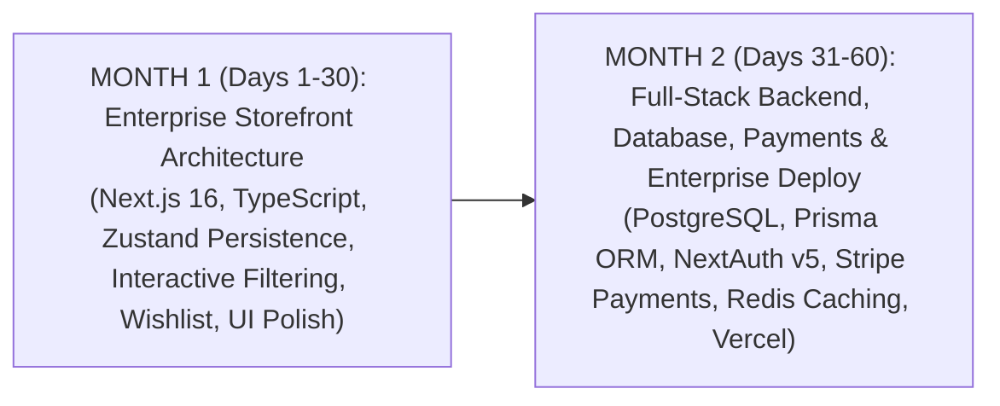
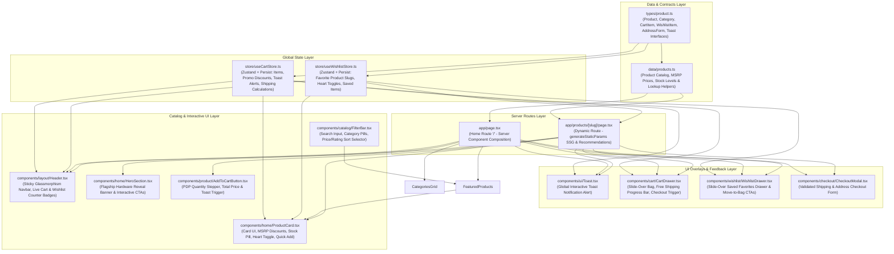

# 📌 60-Day Accelerated Full-Stack Engineering Mastery: Pinned Course Notes & Progress Tracker

> **Target Title:** Senior Frontend / Full-Stack Engineer | React | Next.js | TypeScript | E-Commerce | BigCommerce | Shopify  
> **Project Location:** `D:\NOVA Project\nova-ecommerce`  
> **PDF Study Guide Location:** `D:\NOVA Project\NOVA_Course_Day1_Day2_Notes.pdf`

---

## 🎯 60-Day Accelerated Transformation Roadmap

---

## 🗺️ Codebase Architecture & System Dependency Diagram

---

## 📖 Recommended File Study Order

Follow this 12-step sequence when opening files in VS Code to learn the codebase:

1. **[types/product.ts](file:///D:/NOVA%20Project/nova-ecommerce/types/product.ts):** Study data interfaces for products, cart items, wishlist items, checkout address validation, and toast notifications.
2. **[data/products.ts](file:///D:/NOVA%20Project/nova-ecommerce/data/products.ts):** Learn catalog storage with MSRP prices, stock levels, tags, and `getProductBySlug()` lookup helper.
3. **[store/useCartStore.ts](file:///D:/NOVA%20Project/nova-ecommerce/store/useCartStore.ts):** Master Zustand state management with `persist` middleware (`localStorage`), promo discount logic, and toast dispatchers.
4. **[store/useWishlistStore.ts](file:///D:/NOVA%20Project/nova-ecommerce/store/useWishlistStore.ts):** Learn dedicated Zustand wishlist persistence for toggling favorite products (`toggleWishlist`).
5. **[components/ui/Toast.tsx](file:///D:/NOVA%20Project/nova-ecommerce/components/ui/Toast.tsx):** Study interactive client toast notifications and auto-dismiss timer lifecycle.
6. **[components/layout/Header.tsx](file:///D:/NOVA%20Project/nova-ecommerce/components/layout/Header.tsx):** Learn glassmorphism navbar styling, hydration safety (`isMounted`), and dual badges (Cart & Wishlist).
7. **[components/wishlist/WishlistDrawer.tsx](file:///D:/NOVA%20Project/nova-ecommerce/components/wishlist/WishlistDrawer.tsx):** Study slide-over wishlist drawer rendering saved items with direct "Move to Bag" actions.
8. **[components/checkout/CheckoutModal.tsx](file:///D:/NOVA%20Project/nova-ecommerce/components/checkout/CheckoutModal.tsx):** Master enterprise form validation for shipping addresses, postal codes, and email verification.
9. **[components/cart/CartDrawer.tsx](file:///D:/NOVA%20Project/nova-ecommerce/components/cart/CartDrawer.tsx):** Learn slide-over bag state, free shipping percentage calculator ($99 goal), promo code discounts, and checkout trigger.
10. **[components/catalog/FilterBar.tsx](file:///D:/NOVA%20Project/nova-ecommerce/components/catalog/FilterBar.tsx):** Learn real-time search filtering, category pills, sorting algorithms, and stock toggle logic.
11. **[components/home/ProductCard.tsx](file:///D:/NOVA%20Project/nova-ecommerce/components/home/ProductCard.tsx):** Study human-crafted e-commerce card design with interactive heart buttons, MSRP discounts, and stock badges.
12. **[app/page.tsx](file:///D:/NOVA%20Project/nova-ecommerce/app/page.tsx):** Master React Server Component (RSC) page layout composition.

---

## 📓 Daily Progress Log

### ✅ Day 1: Project Foundation & Next.js Fundamentals
- **Setup:** Configured Next.js 16 (App Router), React 19, TypeScript, Tailwind CSS v4.
- **Root Layout:** Built `app/layout.tsx` with Google Geist fonts, global CSS, and SEO metadata.
- **Homepage:** Created layout sections in `app/page.tsx`.

### ✅ Day 2: Modular Architecture, Dynamic Routing & Zustand State Management
- **Type Contracts:** Created `types/product.ts` for `Product`, `Category`, `CartItem`.
- **Database Catalog:** Created `data/products.ts` with mock items and `getProductBySlug()` lookup helper.
- **Global Cart State:** Created `store/useCartStore.ts` using **Zustand** for atomic state management.
- **Dynamic Route (PDP):** Built `app/products/[slug]/page.tsx` pre-rendering dynamic routes as Static Site Generation (SSG).

### ✅ Day 3: Enterprise UI Redesign, Dynamic Search Filtering, Live Toast Notifications & Persisted State
- **Enterprise Design System Overhaul:** Redesigned UI into a sleek, production-grade storefront with MSRP discount tags, star ratings, and stock indicators.
- **Zustand LocalStorage Persistence:** Integrated `persist` middleware in `store/useCartStore.ts`.
- **Global Toast Notification System:** Created `components/ui/Toast.tsx` providing slide-in confirmation feedback.
- **Dynamic Search & Filtering Bar:** Created `components/catalog/FilterBar.tsx` providing real-time text search, category pills, price sorting, and stock toggles.

### ✅ Day 4: Wishlist System, Form Validation & Human-Crafted E-Commerce UI Polish (Accelerated 60-Day Track)
- **Persistent Wishlist Store:** Created `store/useWishlistStore.ts` with Zustand `persist` middleware to track user favorite products across sessions.
- **Interactive Wishlist Drawer:** Built `components/wishlist/WishlistDrawer.tsx` allowing users to view saved favorite items and move them directly to their shopping bag.
- **Enterprise Checkout Modal & Form Validation:** Built `components/checkout/CheckoutModal.tsx` featuring real-time input validation for Email, Full Name, Street Address, City, Postal Code, and Phone Number.
- **Human-Crafted UI Design Realism:** Refined components ([ProductCard.tsx](file:///D:/NOVA%20Project/nova-ecommerce/components/home/ProductCard.tsx), [Header.tsx](file:///D:/NOVA%20Project/nova-ecommerce/components/layout/Header.tsx), [HeroSection.tsx](file:///D:/NOVA%20Project/nova-ecommerce/components/home/HeroSection.tsx), [CartDrawer.tsx](file:///D:/NOVA%20Project/nova-ecommerce/components/cart/CartDrawer.tsx)) with organic micro-interactions, subtle borders, realistic customer quotes, interactive heart toggles, and human-crafted visual details.
- **Deep Code Documentation:** Added thorough inline JSDoc and architectural block comments across all new and updated files explaining parameters, props, and design logic.

---

## 💡 Senior Technical Interview Reference

> **Q1: How do you implement a persistent Wishlist system in React without backend API dependencies?**  
> *Answer:* We create a dedicated Zustand store (`useWishlistStore`) configured with `persist` middleware targeting `localStorage` under key `"nova-wishlist-storage"`. The store maintains an array of unique product IDs (`wishlistIds: string[]`) and provides an atomic toggle method (`toggleWishlist(id)`). Components subscribe only to the wishlist IDs array to re-render heart icons without affecting other cart or UI components.

> **Q2: Why handle form validation with real-time touch feedback in client checkout modals?**  
> *Answer:* Real-time validation checks input fields as users type or blur, giving immediate visual feedback (red focus ring for invalid emails/postal codes, green border for valid fields). This prevents frustrating full-form submission rejections, improves conversion rates, and ensures clean data formatting before dispatching orders.

> **Q3: What design techniques prevent an e-commerce UI from feeling "AI-generated" or generic?**  
> *Answer:* Human-crafted UI design relies on asymmetrical spacing balance, authentic typography contrast, realistic product copy, micro-animations (heart pulse, progress fills), real user review quotes (`"Verified Buyer"`), genuine stock availability indicators (`"Only 4 left"`), and subtle border/shadow layers (`backdrop-blur`, `border-slate-800/80`) rather than standard generic templates.
