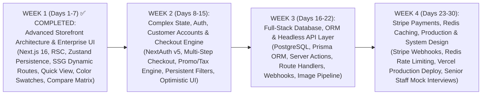

# 📌 30-Day Accelerated Full-Stack Engineering Mastery: Pinned Course Notes & Progress Tracker

> **Target Title:** Senior Frontend / Full-Stack Engineer | React | Next.js | TypeScript | E-Commerce | BigCommerce | Shopify  
> **Project Location:** `D:\NOVA Project\nova-ecommerce`  
> **PDF Study Guide Location:** `D:\NOVA Project\NOVA_Course_Day1_Day2_Notes.pdf`

---

## 🎯 30-Day Fast-Track Transformation Roadmap (1-Month Intensive)

---

## 🗺️ Codebase Architecture & System Dependency Diagram

```mermaid
flowchart TD
    subgraph Data & Contracts Layer
        Types["types/product.ts<br/>(Product, ColorVariant, Review, RecentlyViewedRecord Interfaces)"]
        Data["data/products.ts<br/>(8 Flagship Products, Color Finishes, Specs, Verified Reviews & Lookup Utilities)"]
    end

    subgraph Global State Layer
        CartStore["store/useCartStore.ts<br/>(Zustand + Persist: Cart Items, Discounts, Toast Alerts, Shipping Calculations)"]
        WishlistStore["store/useWishlistStore.ts<br/>(Zustand + Persist: Saved Favorites, Heart Toggles, Session Storage)"]
        CompareStore["store/useCompareStore.ts<br/>(Zustand + Persist: Side-by-Side Product Comparison Matrix & Limit Gates)"]
        RecentlyViewedStore["store/useRecentlyViewedStore.ts<br/>(Zustand + Persist: Browsing History Array & Deduplication Engine)"]
        QuickViewStore["store/useQuickViewStore.ts<br/>(Zustand: Quick View Active Product & Modal Visibility State)"]
    end

    subgraph UI Overlays & Feedback Layer
        Toast["components/ui/Toast.tsx<br/>(Global Interactive Toast Notification Alert)"]
        CartDrawer["components/cart/CartDrawer.tsx<br/>(Slide-Over Bag, Free Shipping Progress Bar, Checkout Trigger)"]
        WishlistDrawer["components/wishlist/WishlistDrawer.tsx<br/>(Slide-Over Saved Favorites Drawer & Move-to-Bag CTAs)"]
        CompareDrawer["components/compare/ProductCompareDrawer.tsx<br/>(Multi-Product Specs Matrix & Sticky Bottom Floating Dock)"]
        QuickViewModal["components/catalog/QuickViewModal.tsx<br/>(Interactive Quick View Inspection Modal & Color Swatches)"]
        SearchModal["components/catalog/SearchModal.tsx<br/>(Command-K ⌘K Live Quick Search Modal & Instant Previews)"]
        CheckoutModal["components/checkout/CheckoutModal.tsx<br/>(Validated Shipping & Address Checkout Form)"]
    end

    subgraph Catalog & Interactive UI Layer
        Header["components/layout/Header.tsx<br/>(Sticky Glassmorphism Navbar, Search Trigger & Triple Counter Badges)"]
        FilterBar["components/catalog/FilterBar.tsx<br/>(Search Input, Category Pills, Price/Rating Sort Selector)"]
        HeroSection["components/home/HeroSection.tsx<br/>(Flagship Hardware Reveal Banner & Interactive CTAs)"]
        ProductCard["components/home/ProductCard.tsx<br/>(Card UI, Quick View Hover, Swatches, Heart & Compare Toggles)"]
        ColorSwatchPicker["components/product/ColorSwatchPicker.tsx<br/>(Hardware Finish Selector Dots & Controlled Active Rings)"]
        ProductReviews["components/product/ProductReviews.tsx<br/>(Rating Distribution Bar Chart, Verified Reviews & Submission Form)"]
        RecentlyViewedSection["components/home/RecentlyViewedSection.tsx<br/>(Dynamic Browsing History Carousel & Clear Action)"]
        AddToCartBtn["components/product/AddToCartButton.tsx<br/>(PDP Quantity Stepper, Color Swatches, History Logger & Toast Trigger)"]
    end

    subgraph Server Routes Layer
        Home["app/page.tsx<br/>(Home Route '/' - Server Component Composition)"]
        PDP["app/products/[slug]/page.tsx<br/>(Dynamic Route - generateStaticParams SSG, Reviews & History)"]
        CategoryPage["app/categories/[slug]/page.tsx<br/>(Dynamic Category Department Route - generateStaticParams SSG)"]
    end

    Types --> Data
    Types --> CartStore
    Types --> WishlistStore
    Types --> CompareStore
    Types --> RecentlyViewedStore
    Types --> QuickViewStore
    Data --> Home
    Data --> PDP
    Data --> CategoryPage
    CartStore --> Header
    CartStore --> CartDrawer
    CartStore --> Toast
    CartStore --> ProductCard
    WishlistStore --> Header
    WishlistStore --> WishlistDrawer
    WishlistStore --> ProductCard
    CompareStore --> Header
    CompareStore --> CompareDrawer
    CompareStore --> ProductCard
    QuickViewStore --> QuickViewModal
    QuickViewStore --> ProductCard
    RecentlyViewedStore --> RecentlyViewedSection
    RecentlyViewedStore --> AddToCartBtn
    RecentlyViewedStore --> QuickViewStore
    FilterBar --> FeaturedProducts
    FeaturedProducts --> ProductCard
    Home --> Header
    Home --> Toast
    Home --> CartDrawer
    Home --> WishlistDrawer
    Home --> CompareDrawer
    Home --> QuickViewModal
    Home --> SearchModal
    Home --> CheckoutModal
    Home --> HeroSection
    Home --> CategoriesGrid
    Home --> FeaturedProducts
    Home --> RecentlyViewedSection
    PDP --> Header
    PDP --> Toast
    PDP --> CartDrawer
    PDP --> WishlistDrawer
    PDP --> CompareDrawer
    PDP --> QuickViewModal
    PDP --> SearchModal
    PDP --> CheckoutModal
    PDP --> ProductReviews
    PDP --> AddToCartBtn
    PDP --> ProductCard
    PDP --> RecentlyViewedSection
    CategoryPage --> Header
    CategoryPage --> Toast
    CategoryPage --> CartDrawer
    CategoryPage --> WishlistDrawer
    CategoryPage --> CompareDrawer
    CategoryPage --> QuickViewModal
    CategoryPage --> SearchModal
    CategoryPage --> CheckoutModal
    CategoryPage --> FeaturedProducts
```

---

## 📖 Recommended File Study Order (For Beginners & Advanced Learners)

Follow this 15-step sequence when opening files in VS Code to learn the codebase:

1. **[types/product.ts](file:///D:/NOVA%20Project/nova-ecommerce/types/product.ts):** Study TypeScript blueprints — learn what an `interface` is, what optional `?` fields mean, and how data contracts prevent runtime bugs.
2. **[data/products.ts](file:///D:/NOVA%20Project/nova-ecommerce/data/products.ts):** Study our mock in-memory database — see how 8 products, color finishes, and specs are queried using `.find()` and `.filter()`.
3. **[store/useRecentlyViewedStore.ts](file:///D:/NOVA%20Project/nova-ecommerce/store/useRecentlyViewedStore.ts):** Learn how browsing history is recorded, deduplicated, and persisted to browser `localStorage`.
4. **[store/useQuickViewStore.ts](file:///D:/NOVA%20Project/nova-ecommerce/store/useQuickViewStore.ts):** Learn how lightweight Zustand stores coordinate modal popups across unrelated components.
5. **[components/product/ColorSwatchPicker.tsx](file:///D:/NOVA%20Project/nova-ecommerce/components/product/ColorSwatchPicker.tsx):** Study controlled React components and "Lifting State Up" when selecting color variants.
6. **[components/catalog/QuickViewModal.tsx](file:///D:/NOVA%20Project/nova-ecommerce/components/catalog/QuickViewModal.tsx):** Study popup modal architectures, quantity steppers, and purchasing directly from catalog lists.
7. **[components/home/ProductCard.tsx](file:///D:/NOVA%20Project/nova-ecommerce/components/home/ProductCard.tsx):** Study how `e.preventDefault()` halts parent `<Link>` navigation when clicking Quick View, Compare, Wishlist, or Add to Bag.
8. **[components/home/RecentlyViewedSection.tsx](file:///D:/NOVA%20Project/nova-ecommerce/components/home/RecentlyViewedSection.tsx):** Study how browsing history is rendered dynamically, and how `currentProductId` prevents showing the active PDP item in its own history.
9. **[store/useCartStore.ts](file:///D:/NOVA%20Project/nova-ecommerce/store/useCartStore.ts):** Master Zustand state management with `persist` middleware (`localStorage`), promo discount logic, and toast dispatchers.
10. **[store/useCompareStore.ts](file:///D:/NOVA%20Project/nova-ecommerce/store/useCompareStore.ts):** Learn multi-product comparison state management, maximum limits (`MAX_COMPARE_LIMIT = 4`), and cross-store toast triggers.
11. **[components/compare/ProductCompareDrawer.tsx](file:///D:/NOVA%20Project/nova-ecommerce/components/compare/ProductCompareDrawer.tsx):** Study sticky floating bottom dock and fullscreen side-by-side technical specifications comparison table.
12. **[app/categories/[slug]/page.tsx](file:///D:/NOVA%20Project/nova-ecommerce/app/categories/[slug]/page.tsx):** Master dynamic category department SSG routes (`generateStaticParams()`), department banners, and breadcrumb navigation.
13. **[components/product/ProductReviews.tsx](file:///D:/NOVA%20Project/nova-ecommerce/components/product/ProductReviews.tsx):** Study rating distribution bar chart algorithms, verified buyer badges, and "Write a Review" modal form logic.
14. **[components/layout/Header.tsx](file:///D:/NOVA%20Project/nova-ecommerce/components/layout/Header.tsx):** Learn glassmorphism navbar styling, search trigger, and triple counter badges (Bag, Wishlist, Compare).
15. **[components/layout/ClientOverlays.tsx](file:///D:/NOVA%20Project/nova-ecommerce/components/layout/ClientOverlays.tsx):** Understand how centralizing client overlays into one client wrapper preserves server rendering for all page routes (`/`, `/products/[slug]`, `/categories/[slug]`).

---

## 📓 Daily Progress Log

### ✅ Day 1: Project Foundation & Next.js Fundamentals
- **Setup:** Configured Next.js 16 (App Router), React 19, TypeScript, Tailwind CSS v4.
- **Root Layout:** Built `app/layout.tsx`.

### ✅ Day 2: Modular Architecture, Dynamic Routing & Zustand State Management
- **Type Contracts & Catalog:** Created `types/product.ts`, `data/products.ts`, `store/useCartStore.ts`.
- **Dynamic Route (PDP):** Built `app/products/[slug]/page.tsx` pre-rendering dynamic routes as Static Site Generation (SSG).

### ✅ Day 3: Enterprise UI Redesign, Dynamic Search Filtering, Live Toast Notifications & Persisted State
- **Enterprise Design System Overhaul:** Redesigned UI into a sleek storefront with MSRP discount tags, star ratings, and stock indicators.
- **Zustand LocalStorage Persistence & Toast System:** Integrated `persist` middleware in `store/useCartStore.ts` and created `components/ui/Toast.tsx`.
- **Dynamic Filtering:** Built `components/catalog/FilterBar.tsx`.

### ✅ Day 4: Wishlist System, Form Validation & Human-Crafted E-Commerce UI Polish
- **Persistent Wishlist & Checkout Validation:** Built `store/useWishlistStore.ts`, `WishlistDrawer.tsx`, and `CheckoutModal.tsx`.

### ✅ Day 5: Customer Reviews & Ratings System, Command-K Quick Search & Exhaustive Code Documentation
- **Verified Customer Reviews System:** Created `components/product/ProductReviews.tsx` featuring rating score distribution charts (5-star, 4-star breakdown), verified buyer badges, helpful upvote buttons, and an interactive **"Write a Review"** modal form.
- **Command-K (⌘K / Ctrl+K) Quick Search Overlay:** Created `components/catalog/SearchModal.tsx` providing real-time keyboard shortcut listeners (`⌘K`, `Ctrl+K`, `Escape`).

### ✅ Day 6: Dynamic Category Department Routes & Multi-Product Comparison Matrix
- **Dynamic Category Department Route:** Built `app/categories/[slug]/page.tsx` pre-rendering all 4 departments (`/categories/audio-tech`, `/categories/wearables`, `/categories/smart-home`, `/categories/accessories`) as Static Site Generation (SSG).
- **Multi-Product Specs Comparison Matrix:** Built `components/compare/ProductCompareDrawer.tsx` featuring sticky floating bottom dock and specs matrix table.
- **Comparison Store:** Created `store/useCompareStore.ts` with Zustand `persist` middleware.

### ✅ Day 7: Quick View Modal System, Browsing History Engine, Color Swatches & Week 1 Mastery Complete!
- **Interactive Quick View Modal:** Built `components/catalog/QuickViewModal.tsx` and `store/useQuickViewStore.ts` allowing customers to preview full specs, select color finishes, adjust quantities, and add items to bag directly from any catalog grid without leaving the page.
- **Browsing History & Recently Viewed Engine:** Created `store/useRecentlyViewedStore.ts` with `localStorage` persistence and deduplication, and built `components/home/RecentlyViewedSection.tsx` rendered dynamically on PDP and homepage.
- **Interactive Color Swatch Finishes:** Created `components/product/ColorSwatchPicker.tsx` with animated active rings, finish names, and integrated it into both Quick View and PDP purchasing panels.
- **Product Card Quick View Hover Trigger:** Updated `components/home/ProductCard.tsx` with a smooth hover Quick View CTA and color finish preview dots.
- **Beginner-Friendly Code Documentation:** Added thorough line-by-line and block-by-block beginner comments explaining `interfaces`, `useState`, `useEffect`, `localStorage`, array methods (`.filter`, `.slice`, `.map`), and event bubbling across all files.

---

## 💡 Senior Technical Interview Reference

> **Q1: How do you build an efficient "Recently Viewed Products" feature in React with zero backend latency?**  
> *Answer:* We implement a client-side store (`useRecentlyViewedStore`) backed by `localStorage` using Zustand's `persist` middleware. When a user views a product page or triggers Quick View, the product ID is passed to `addViewedProduct(productId)`. The store performs in-memory deduplication (`state.recentIds.filter(id => id !== productId)`), prepends the newest ID to index 0 (`[productId, ...filtered]`), and enforces an 8-item cap (`.slice(0, 8)`). This ensures 0ms latency, zero database query overhead, and instant persistence across user browsing sessions.

> **Q2: What is "Lifting State Up" in React, and how is it used in the Color Swatch Picker?**  
> *Answer:* When multiple child components or a parent need access to the same state (like knowing which color finish the customer selected so the Add-to-Bag button can save it), the state is defined in the parent component (`const [selectedColor, setSelectedColor] = useState(...)`). The parent passes the current value (`selectedColor`) and a setter function (`onSelectColor={setSelectedColor}`) down to the child `<ColorSwatchPicker />`. When the user clicks a swatch, the child calls the function to update the parent's state.

> **Q3: Why is event bubbling prevention (`e.preventDefault()`) essential in e-commerce card architectures?**  
> *Answer:* E-commerce product cards typically encapsulate their entire body in an anchor tag or Next.js `<Link>` to navigate to the product detail page. However, modern cards also contain nested action triggers (Add to Bag, Wishlist Heart, Compare Toggle, Quick View). Without calling `e.preventDefault()`, the browser bubbles the click event up to the parent anchor tag, triggering unwanted page redirects while the user was simply trying to add an item to their cart or favorites list.
