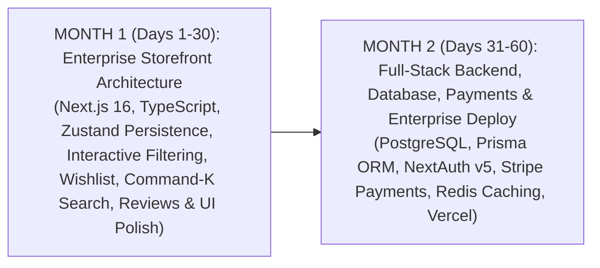

# 📌 60-Day Accelerated Full-Stack Engineering Mastery: Pinned Course Notes & Progress Tracker

> **Target Title:** Senior Frontend / Full-Stack Engineer | React | Next.js | TypeScript | E-Commerce | BigCommerce | Shopify  
> **Project Location:** `D:\NOVA Project\nova-ecommerce`  
> **PDF Study Guide Location:** `D:\NOVA Project\NOVA_Course_Day1_Day2_Notes.pdf`

---

## 🎯 60-Day Accelerated Transformation Roadmap

---

## 🗺️ Codebase Architecture & System Dependency Diagram

```mermaid
flowchart TD
    subgraph Data & Contracts Layer
        Types["types/product.ts<br/>(Product, Category, CartItem, Review, AddressForm, Toast Interfaces)"]
        Data["data/products.ts<br/>(Product Catalog, Verified Customer Reviews, MSRP Prices & Lookup Helpers)"]
    end

    subgraph Global State Layer
        CartStore["store/useCartStore.ts<br/>(Zustand + Persist: Items, Promo Discounts, Toast Alerts, Shipping Calculations)"]
        WishlistStore["store/useWishlistStore.ts<br/>(Zustand + Persist: Favorite Product Slugs, Heart Toggles, Saved Items)"]
    end

    subgraph UI Overlays & Feedback Layer
        Toast["components/ui/Toast.tsx<br/>(Global Interactive Toast Notification Alert)"]
        CartDrawer["components/cart/CartDrawer.tsx<br/>(Slide-Over Bag, Free Shipping Progress Bar, Checkout Trigger)"]
        WishlistDrawer["components/wishlist/WishlistDrawer.tsx<br/>(Slide-Over Saved Favorites Drawer & Move-to-Bag CTAs)"]
        SearchModal["components/catalog/SearchModal.tsx<br/>(Command-K ⌘K Live Quick Search Modal & Instant Previews)"]
        CheckoutModal["components/checkout/CheckoutModal.tsx<br/>(Validated Shipping & Address Checkout Form)"]
    end

    subgraph Catalog & Interactive UI Layer
        Header["components/layout/Header.tsx<br/>(Sticky Glassmorphism Navbar, Search Trigger & Dual Counter Badges)"]
        FilterBar["components/catalog/FilterBar.tsx<br/>(Search Input, Category Pills, Price/Rating Sort Selector)"]
        HeroSection["components/home/HeroSection.tsx<br/>(Flagship Hardware Reveal Banner & Interactive CTAs)"]
        ProductCard["components/home/ProductCard.tsx<br/>(Card UI, MSRP Discounts, Stock Pill, Heart Toggle, Quick Add)"]
        ProductReviews["components/product/ProductReviews.tsx<br/>(Rating Distribution Bar Chart, Verified Reviews & Submission Form)"]
        AddToCartBtn["components/product/AddToCartButton.tsx<br/>(PDP Quantity Stepper, Total Price & Toast Trigger)"]
    end

    subgraph Server Routes Layer
        Home["app/page.tsx<br/>(Home Route '/' - Server Component Composition)"]
        PDP["app/products/[slug]/page.tsx<br/>(Dynamic Route - generateStaticParams SSG, Reviews & Recommendations)"]
    end

    Types --> Data
    Types --> CartStore
    Types --> WishlistStore
    Data --> Home
    Data --> PDP
    CartStore --> Header
    CartStore --> CartDrawer
    CartStore --> Toast
    CartStore --> ProductCard
    WishlistStore --> Header
    WishlistStore --> WishlistDrawer
    WishlistStore --> ProductCard
    WishlistStore --> PDP
    FilterBar --> FeaturedProducts
    FeaturedProducts --> ProductCard
    Home --> Header
    Home --> Toast
    Home --> CartDrawer
    Home --> WishlistDrawer
    Home --> SearchModal
    Home --> CheckoutModal
    Home --> HeroSection
    Home --> CategoriesGrid
    Home --> FeaturedProducts
    PDP --> Header
    PDP --> Toast
    PDP --> CartDrawer
    PDP --> WishlistDrawer
    PDP --> SearchModal
    PDP --> CheckoutModal
    PDP --> ProductReviews
    PDP --> AddToCartBtn
    PDP --> ProductCard
```

---

## 📖 Recommended File Study Order

Follow this 13-step sequence when opening files in VS Code to learn the codebase:

1. **[types/product.ts](file:///D:/NOVA%20Project/nova-ecommerce/types/product.ts):** Study data contracts for products, cart items, customer reviews (`Review`), wishlist items, checkout address validation, and toast notifications.
2. **[data/products.ts](file:///D:/NOVA%20Project/nova-ecommerce/data/products.ts):** Learn catalog storage with verified customer review arrays, MSRP prices, stock levels, tags, and `getProductBySlug()` lookup helper.
3. **[store/useCartStore.ts](file:///D:/NOVA%20Project/nova-ecommerce/store/useCartStore.ts):** Master Zustand state management with `persist` middleware (`localStorage`), promo discount logic, and toast dispatchers.
4. **[store/useWishlistStore.ts](file:///D:/NOVA%20Project/nova-ecommerce/store/useWishlistStore.ts):** Learn dedicated Zustand wishlist persistence for toggling favorite products (`toggleWishlist`).
5. **[components/ui/Toast.tsx](file:///D:/NOVA%20Project/nova-ecommerce/components/ui/Toast.tsx):** Study interactive client toast notifications and auto-dismiss timer lifecycle.
6. **[components/catalog/SearchModal.tsx](file:///D:/NOVA%20Project/nova-ecommerce/components/catalog/SearchModal.tsx):** Study Command-K (`⌘K` / `Ctrl+K`) keyboard shortcut event listeners, live filtering algorithms, and product preview links.
7. **[components/product/ProductReviews.tsx](file:///D:/NOVA%20Project/nova-ecommerce/components/product/ProductReviews.tsx):** Study rating distribution bar chart algorithms, verified buyer badges, upvote counters, and "Write a Review" modal form logic.
8. **[components/layout/Header.tsx](file:///D:/NOVA%20Project/nova-ecommerce/components/layout/Header.tsx):** Learn glassmorphism navbar styling, search trigger (`id="global-search-trigger"`), and dual badges (Cart & Wishlist).
9. **[components/wishlist/WishlistDrawer.tsx](file:///D:/NOVA%20Project/nova-ecommerce/components/wishlist/WishlistDrawer.tsx):** Study slide-over wishlist drawer rendering saved items with direct "Move to Bag" actions.
10. **[components/checkout/CheckoutModal.tsx](file:///D:/NOVA%20Project/nova-ecommerce/components/checkout/CheckoutModal.tsx):** Master enterprise form validation for shipping addresses, postal codes, and email verification.
11. **[components/cart/CartDrawer.tsx](file:///D:/NOVA%20Project/nova-ecommerce/components/cart/CartDrawer.tsx):** Learn slide-over bag state, free shipping percentage calculator ($99 goal), promo code discounts, and checkout trigger.
12. **[components/home/ProductCard.tsx](file:///D:/NOVA%20Project/nova-ecommerce/components/home/ProductCard.tsx):** Study human-crafted e-commerce card design with interactive heart buttons, MSRP discounts, and stock badges.
13. **[app/products/[slug]/page.tsx](file:///D:/NOVA%20Project/nova-ecommerce/app/products/[slug]/page.tsx):** Master dynamic route SSG (`generateStaticParams()`), integrated `<ProductReviews />`, and hardware recommendations.

---

## 📓 Daily Progress Log

### ✅ Day 1: Project Foundation & Next.js Fundamentals
- **Setup:** Configured Next.js 16 (App Router), React 19, TypeScript, Tailwind CSS v4.
- **Root Layout:** Built `app/layout.tsx`.

### ✅ Day 2: Modular Architecture, Dynamic Routing & Zustand State Management
- **Type Contracts & Catalog:** Created `types/product.ts`, `data/products.ts`, `store/useCartStore.ts`.
- **Dynamic Route (PDP):** Built `app/products/[slug]/page.tsx` pre-rendering dynamic routes as Static Site Generation (SSG).

### ✅ Day 3: Enterprise UI Redesign, Dynamic Search Filtering, Live Toast Notifications & Persisted State
- **Enterprise Design System Overhaul:** Redesigned UI into a sleek storefront with MSRP discount tags, star ratings, and stock indicators.
- **Zustand LocalStorage Persistence & Toast System:** Integrated `persist` middleware in `store/useCartStore.ts` and created `components/ui/Toast.tsx`.
- **Dynamic Filtering:** Built `components/catalog/FilterBar.tsx`.

### ✅ Day 4: Wishlist System, Form Validation & Human-Crafted E-Commerce UI Polish
- **Persistent Wishlist & Checkout Validation:** Built `store/useWishlistStore.ts`, `WishlistDrawer.tsx`, and `CheckoutModal.tsx`.

### ✅ Day 5: Customer Reviews & Ratings System, Command-K Quick Search & Exhaustive Code Documentation (Accelerated 60-Day Track)
- **Verified Customer Reviews System:** Created `components/product/ProductReviews.tsx` featuring rating score distribution charts (5-star, 4-star breakdown), verified buyer badges (`✓ Verified Buyer`), helpful upvote buttons (`👍 Helpful (34)`), and an interactive **"Write a Review"** modal form with star rating pickers.
- **Command-K (⌘K / Ctrl+K) Quick Search Overlay:** Created `components/catalog/SearchModal.tsx` providing real-time keyboard shortcut listeners (`⌘K`, `Ctrl+K`, `Escape`), category quick filter pills, and live instant search result previews.
- **Exhaustive Code Documentation:** Added line-by-line / block-by-block explanatory comments across all files detailing data contracts, parameters, hooks, event handlers, and design rationale.

---

## 💡 Senior Technical Interview Reference

> **Q1: How do you implement global keyboard shortcuts (e.g. ⌘K / Ctrl+K) in Next.js without memory leaks?**  
> *Answer:* We attach a global event listener to the `window` object inside a `useEffect` hook (`window.addEventListener('keydown', handleKeyDown)`). To prevent memory leaks and duplicate handler bindings, we MUST return a cleanup function (`return () => window.removeEventListener('keydown', handleKeyDown)`). Inside the handler, we check `e.metaKey` (Mac Command key) or `e.ctrlKey` (Windows Ctrl key) alongside `e.key.toLowerCase() === 'k'`.

> **Q2: How do you calculate rating distribution bar charts dynamically in React?**  
> *Answer:* Given an array of reviews (`Review[]`), we iterate through the list to accumulate total counts per star score (`1` to `5`). We compute the relative percentage for each star tier (`(starCount / totalReviews) * 100`) and pass that percentage to CSS width styles (`style={{ width: '${percent}%' }}`). Using `Math.round()` ensures clean rendering without fractional overflow.

> **Q3: Why isolate overlay state management inside a client wrapper (`ClientOverlays.tsx`)?**  
> *Answer:* Isolating interactive overlays (Toast, CartDrawer, WishlistDrawer, SearchModal, CheckoutModal) inside a single `'use client'` component allows page containers (`app/page.tsx`, `app/products/[slug]/page.tsx`) to remain pure React Server Components (RSC). This preserves server-rendered HTML output, eliminates initial JS bundle penalties for static content, and optimizes First Contentful Paint (FCP).
