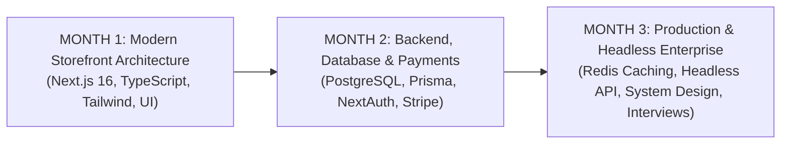

# 📌 90-Day Full-Stack Engineering Mastery: Pinned Course Notes & Progress Tracker

> **Target Title:** Frontend Engineer | React | Next.js | TypeScript | E-Commerce | BigCommerce | Shopify  
> **Project Location:** `D:\NOVA Project\nova-ecommerce`  
> **PDF Study Guide Location:** `D:\NOVA Project\NOVA_Course_Day1_Day2_Notes.pdf`

---

## 🎯 90-Day Transformation Roadmap



---

## 🗺️ Codebase Architecture & System Dependency Diagram

```mermaid
flowchart TD
    subgraph Data & Contracts Layer
        Types["types/product.ts<br/>(Product, Category, CartItem, ToastNotification Interfaces)"]
        Data["data/products.ts<br/>(Product Catalog, MSRP Prices, Stock Levels & getProductBySlug)"]
    end

    subgraph Global State Layer
        Store["store/useCartStore.ts<br/>(Zustand + Persist Middleware: addItem, removeItem, applyPromoCode, Toast Alert)"]
    end

    subgraph UI Overlays & Feedback Layer
        Toast["components/ui/Toast.tsx<br/>(Global Interactive Toast Notification Alert)"]
        CartDrawer["components/cart/CartDrawer.tsx<br/>(Slide-Over Bag, Free Shipping Progress Bar, Promo Code Input)"]
    end

    subgraph Catalog & Interactive UI Layer
        Header["components/layout/Header.tsx<br/>(Sticky Glassmorphism Navbar & Live Animated Cart Counter Badge)"]
        FilterBar["components/catalog/FilterBar.tsx<br/>(Search Input, Category Pills, Price/Rating Sort Selector)"]
        HeroSection["components/home/HeroSection.tsx<br/>(Flagship Reveal Banner & Quick Add CTA)"]
        ProductCard["components/home/ProductCard.tsx<br/>(Card UI, MSRP Discounts, Stock Pill, Quick Add)"]
        AddToCartBtn["components/product/AddToCartButton.tsx<br/>(PDP Quantity Stepper, Total Price & Toast Trigger)"]
    </div>

    subgraph Server Routes Layer
        Home["app/page.tsx<br/>(Home Route '/' - Server Component Composition)"]
        PDP["app/products/[slug]/page.tsx<br/>(Dynamic Route - generateStaticParams SSG & Recommendations)"]
    end

    Types --> Data
    Types --> Store
    Data --> Home
    Data --> PDP
    Store --> Header
    Store --> CartDrawer
    Store --> Toast
    Store --> ProductCard
    Store --> AddToCartBtn
    FilterBar --> FeaturedProducts
    FeaturedProducts --> ProductCard
    Home --> Header
    Home --> Toast
    Home --> CartDrawer
    Home --> HeroSection
    Home --> CategoriesGrid
    Home --> FeaturedProducts
    PDP --> Header
    PDP --> Toast
    PDP --> CartDrawer
    PDP --> AddToCartBtn
    PDP --> ProductCard
```

---

## 📖 Recommended File Study Order

Follow this 10-step sequence when opening files in VS Code to learn the codebase:

1. **[types/product.ts](file:///D:/NOVA%20Project/nova-ecommerce/types/product.ts):** Learn data contracts, MSRP discount fields, stock levels, and `ToastNotification` interface.
2. **[data/products.ts](file:///D:/NOVA%20Project/nova-ecommerce/data/products.ts):** Learn catalog storage with MSRP prices, tags, and `getProductBySlug()` lookup helper.
3. **[store/useCartStore.ts](file:///D:/NOVA%20Project/nova-ecommerce/store/useCartStore.ts):** Master Zustand state management with `persist` middleware (`localStorage`), promo code discount logic, and toast dispatchers.
4. **[components/ui/Toast.tsx](file:///D:/NOVA%20Project/nova-ecommerce/components/ui/Toast.tsx):** Study interactive client toast notifications and auto-dismiss timer lifecycle.
5. **[components/layout/Header.tsx](file:///D:/NOVA%20Project/nova-ecommerce/components/layout/Header.tsx):** Learn glassmorphism navbar styling and client hydration safety (`isMounted`).
6. **[components/cart/CartDrawer.tsx](file:///D:/NOVA%20Project/nova-ecommerce/components/cart/CartDrawer.tsx):** Learn slide-over drawer state, free shipping percentage calculator ($99 goal), and promo discount calculations.
7. **[components/catalog/FilterBar.tsx](file:///D:/NOVA%20Project/nova-ecommerce/components/catalog/FilterBar.tsx):** Learn real-time search filtering, category pills, sorting algorithms, and stock toggle logic.
8. **[components/home/ProductCard.tsx](file:///D:/NOVA%20Project/nova-ecommerce/components/home/ProductCard.tsx):** Study e-commerce card design with discount badges, star ratings, and quick add button handlers (`e.preventDefault()`).
9. **[app/page.tsx](file:///D:/NOVA%20Project/nova-ecommerce/app/page.tsx):** Master React Server Component (RSC) page layout composition.
10. **[app/products/[slug]/page.tsx](file:///D:/NOVA%20Project/nova-ecommerce/app/products/[slug]/page.tsx):** Master dynamic route SSG (`generateStaticParams()`), breadcrumb navigation, and related product recommendations.

---

## 📓 Daily Progress Log

### ✅ Day 1: Project Foundation & Next.js Fundamentals
- **Setup:** Configured Next.js 16 (App Router), React 19, TypeScript, Tailwind CSS v4.
- **Root Layout:** Built `app/layout.tsx` with Google Geist fonts, global CSS, and SEO metadata.
- **Homepage:** Created layout sections in `app/page.tsx` (Promo bar, Sticky Header, Hero section, Categories grid, Product grid, Trust badges, Footer).

### ✅ Day 2: Modular Architecture, Dynamic Routing & Zustand State Management
- **Type Contracts:** Created `types/product.ts` for `Product`, `Category`, `CartItem`.
- **Database Catalog:** Created `data/products.ts` with mock items and `getProductBySlug()` lookup helper.
- **Global Cart State:** Created `store/useCartStore.ts` using **Zustand** for atomic state management.
- **Interactive UI:** Built `components/cart/CartDrawer.tsx`, `components/layout/Header.tsx` (cart badge), `components/home/ProductCard.tsx`, `components/home/HeroSection.tsx`, `components/home/CategoriesGrid.tsx`, `components/home/FeaturedProducts.tsx`.
- **Dynamic Route (PDP):** Built `app/products/[slug]/page.tsx` pre-rendering all 4 product pages as Static Site Generation (SSG) via `generateStaticParams()`.
- **PDP Add-to-Cart:** Built `components/product/AddToCartButton.tsx` with quantity controls.

### ✅ Day 3: Enterprise UI Redesign, Dynamic Search Filtering, Live Toast Notifications & Persisted State
- **Enterprise Design System Overhaul:** Transformed the UI into a sleek, production-grade e-commerce storefront (Apple/Nike style). Replaced basic cards with high-contrast slate panels, MSRP discount strike-through prices (`Save 15%`), star rating badges (`★ 4.9 (142)`), and live inventory pills (`Only 6 Left`).
- **Zustand LocalStorage Persistence:** Integrated `persist` middleware from `zustand/middleware` in `store/useCartStore.ts` so cart items and promo discounts persist across browser refreshes under key `"nova-cart-storage"`.
- **Global Toast Notification System:** Created `components/ui/Toast.tsx` providing slide-in confirmation feedback ("Added [Product Name] to your bag!") with auto-dismiss timers and direct "View Bag" navigation.
- **Dynamic Search & Filtering Bar:** Created `components/catalog/FilterBar.tsx` providing real-time text search, category pills, price sorting (`Low to High`, `High to Low`, `Rating`), and stock toggles inside `components/home/FeaturedProducts.tsx`.
- **Cart Drawer Enhancements:** Added dynamic Free Express Shipping Progress Bar ($99 threshold with live percentage fill), interactive promo code field (`NOVANEXT` for $15 OFF), and detailed order summary breakdown (Subtotal, Discount, Shipping, Total).
- **Build Verification:** Verified build cleanly with `npm run build` — 100% clean compilation across 8 static/SSG routes.

---

## 💡 Senior Technical Interview Reference

> **Q1: How do you solve Next.js SSR Hydration Mismatches when using Zustand `localStorage` persistence?**  
> *Answer:* During Server-Side Rendering (SSR), Node.js renders HTML using initial default state (e.g. empty cart `items: []`). When the browser hydrates, `localStorage` supplies stored items. If rendered directly without a hydration guard, React throws a hydration mismatch error (`Text content does not match server-rendered HTML`). We resolve this cleanly by delaying storage-dependent client rendering until after component mount (`const [isMounted, setIsMounted] = useState(false); useEffect(() => setIsMounted(true), []);`).

> **Q2: Why use `useMemo` for client-side catalog filtering and sorting?**  
> *Answer:* In React, whenever a component re-renders (e.g., as user types search queries), executing raw `.filter()` and `.sort()` on large arrays in the main render body re-executes CPU work on every frame. Wrapping catalog transformations inside `useMemo(() => ..., [products, filters])` ensures filtering and sorting execute strictly when dependency values change.

> **Q3: How does a global Toast Notification system decouple UI actions from feedback components?**  
> *Answer:* Instead of having every button manage its own popover state or pass callback props through deep component trees (prop drilling), action triggers (`<ProductCard />`, `<AddToCartButton />`) invoke `addItem(product)` in the global Zustand store. The store updates state and dispatches `toastNotification`. A single global `<Toast />` listener component mounted at the route level reacts instantly to state changes.
